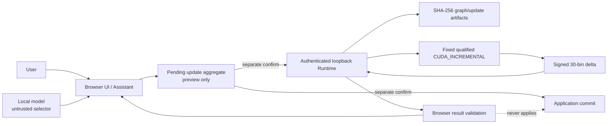

# CANDY Scope 5 security threat model

Scope: first-class DynamicHypergraph pending-update authoring, CUDA_INCREMENTAL analysis, result presentation, and optional authoritative application. Baseline: `57daa23050c89cd0d2c74328766d284311376da4`. No repository `SECURITY.md` policy exists. Scenarios below are design threats, not confirmed vulnerabilities.

## 1. Overview

The browser owns committed graph and confirmation authority. The authenticated loopback CANDY companion owns immutable artifacts, jobs, fixed native execution, cancellation, and accepted results. The native CUDA backend owns exact delta computation but never applies graph state. Scope 5 adds a browser-owned pending update between committed graph state and the already-qualified Runtime path.

| Component | Security role | Evidence |
|---|---|---|
| Application graph controller | Owns committed `hes`, identity/version/fingerprint, history, and commit | `src/App.jsx:321-357`, `src/App.jsx:3601-3645` |
| Mutation planner/preview | Typed operation validation and stale graph/plan checks before non-authoritative preview | `src/graph/graphMutationValidator.js:8-28`, `src/graph/graphMutationPreview.js:13-34` |
| Confirmation controller | Binds action to graph/batch/parser/selection state and expiry | `src/agent/confirmationState.js:7-41`, `src/components/AgentChatPanel.jsx:2542-2556` |
| Browser CANDY workflow | Limits model selector, canonicalizes/upload artifacts, checks async currentness, validates results | `src/candy/motifWorkflow.js:6-52`, `src/candy/useCandyRuntime.js:99-140` |
| Runtime companion | Loopback/origin/bearer boundary; validates submissions and jobs | `candy-runtime/src/server.js:19-29`, `:44-83`; `candy-runtime/src/jobs/jobManager.js:88-117` |
| Artifact store | Content-addressed private storage with reread digest checks | `candy-runtime/src/artifacts/artifactStore.js:19-37`, `:40-92` |
| Native boundary | Fixed qualified executable, bounded file protocol, request digest, CUDA-only delta | `candy-runtime/src/backends/nativeProcessRunner.js:43-128`; `candy-runtime/native/hypergraph-motif-cuda-incremental/README.md:16-22`, `:65-67` |
| Persistence | Stores inert references and drops executable/approval state | `src/persistence/threadStateSchema.js:5-48` |

### Effective resources

| Deployment or workflow | Resource or capability | Configuration and precedence | Safe effective value or location | Readers/writers or recipients | Enforcing control | Evidence or unknowns |
|---|---|---|---|---|---|---|
| Browser Runtime integration | Companion URL | build default/feature configuration | `http://127.0.0.1:8791` or validated loopback origin | Browser and companion | URL validator rejects non-loopback, credentials, query, fragment | `src/candy/client.js:15-36` |
| Runtime session | Pairing credential | random CLI token; browser session copy | OS-temp pairing file; sessionStorage key | Local operator, current browser session, companion | bearer comparison; requested private file mode | `candy-runtime/src/cli.js`; `src/candy/useCandyRuntime.js:9-14`, `:45-51`; Windows ACL effectiveness is host-dependent |
| Runtime artifacts | Graph/update/result bytes | explicit override or `mkdtemp(tmpdir)` | private companion root with SHA-256 filenames | Runtime artifact/job/result handlers | size limits, strict digest paths, exclusive files, rehash on read | `candy-runtime/src/server.js:44-49`; `candy-runtime/src/artifacts/artifactStore.js:19-92` |
| Native request | Packed OLD+update request | trusted packer only | per-job OS-temp `request.txt`, then deleted | fixed native executable | bounded packer, fixed argv, timeout/cancel, cleanup before terminal acceptance | `candy-runtime/src/jobs/jobManager.js:151-175`, `:244-263` |
| Native executable | CUDA_INCREMENTAL binary | qualification record + source/Makefile/binary/evidence/device/toolchain checks | fixed path under frozen native directory | Runtime supervisor/GPU | capability qualification and fixed `shell:false` launch | `candy-runtime/src/capabilities/motifQualification.js`; `candy-runtime/src/backends/nativeProcessRunner.js` |
| Browser thread storage | Inert workspace references | IndexedDB schema projection | `hypergraph-chat-threads` / `threads` | same browser origin | bounded normalization, graph unavailable, pending action null | `src/persistence/threadStore.js:3-18`; `src/persistence/threadStateSchema.js:5-48` |

## 2. Threat model, trust boundaries, and assumptions

### Protected assets

- committed graph content, type, identity, version, and fingerprint;
- exact pending update, plan/preview, update revision/digest, and proposed graph;
- separation of preview, analysis, and apply authority;
- pairing token, Runtime session identity, qualification state, and fixed executable selection;
- graph/update/result artifact integrity and job/request/result identity;
- truthful delta-only semantics and stable 30-class taxonomy;
- availability budgets and absence of orphan native work;
- inert persistence that cannot revive execution authority.

### Actors and capabilities

- **User:** may explicitly stage, analyze, discard, or apply; does not grant one action authority for another.
- **Local model / uploaded content:** untrusted input that may propose bounded typed selectors or mutation intent; cannot provide trusted graph/update bodies, paths, environment, executable, credentials, NEW graph, or candidate tuples.
- **Browser application:** trusted coordinator for live workspace state and confirmation.
- **Runtime companion:** trusted local service after exact bearer/origin checks.
- **Native CUDA process:** trusted only through qualified fixed transport/executable and validated output.
- **Local operator:** already controls the host, build, qualification record, GPU/toolchain, and launch configuration. This is a prerequisite/trust assumption, not authority gained by an HTTP attacker.

### Security objectives

1. A pending update is immutable per revision and bound to exact OLD graph ID/version/fingerprint/type, next version, proposed fingerprint, plan hash, and update digest.
2. Construct/edit, CUDA analysis, and Apply are separate actions; no confirmation token crosses those boundaries.
3. Graph/update/session changes invalidate confirmation, submission, result currency, and application.
4. Analysis never mutates the committed graph and Apply never implicitly runs analysis.
5. Runtime accepts only exact qualified backend/mode/device with immutable artifacts; no CPU/static/projection fallback.
6. Delta results remain delta-only unless a separately validated exact prior static result supports a derived comparison.
7. Cancel, timeout, failure, reload, and Runtime restart cannot yield apply authority.
8. Persisted records are descriptive only and never restore confirmations, graph availability, job bindings, or result authority.
9. Resource checks occur before large copies/uploads/native launch and are rechecked at the enforcing layer.

### Assumptions and unresolved deployment questions

- Scope 5 has not yet defined how explicit isolated vertices live in application state; current `hes` derives vertices from membership while the CANDY contract preserves isolates (`src/App.jsx:3701-3706`; `src/candy/adapters/hypergraphIncidenceAdapter.js:139-152`).
- The local qualification record proves operator-controlled consistency, not publisher authenticity (`candy-runtime/README.md`).
- Pairing/artifact files request private POSIX-style modes, but Windows temp-directory ACL effectiveness was not inspected.
- The current UI fingerprint and mutation plan hash are short FNV-derived markers. They are adequate change detectors, not cryptographic content authorities (`src/graph/graphFingerprint.js:32-39`; `src/graph/graphMutationValidator.js:4-5`). Scope 5 should use SHA-256 update/artifact digests for adversarial binding.
- No application code was executed for this model; existing qualification artifacts are the evidence for native/runtime behavior.

## 3. Attack surface, mitigations, and attacker stories

| Priority | Scenario and capability gain | Prerequisites | Impact | Existing controls | Required Scope-5 mitigation | Evidence |
|---|---|---|---|---|---|---|
| High | **Stale update replay:** an old update is analyzed or applied after the graph changes | Retained old selector/object or delayed UI action | Delta/commit targets wrong OLD graph | Graph ID/version checks, mutation fingerprint checks, async `contextRef` checks | Bind base fingerprint/type + update revision/digest + proposed fingerprint; consume/supersede once; recheck immediately before upload and commit | `src/graph/graphMutationValidator.js:18-27`; `src/candy/useCandyRuntime.js:99-128` |
| High | **Confirmation replay:** analysis or Apply confirmation is reused after update editing/replacement | Update ID retained or binding omits revision/content | Unintended CUDA job or graph commit | TTL, graph/batch/parser snapshot, CANDY request hash | Separate action types/tokens; include update revision/digest/proposed fingerprint synchronously; mint new ID on edit | `src/agent/confirmationState.js:7-41`; `src/candy/requestPolicy.js:17-40` |
| High | **Graph version/next-version manipulation:** caller claims an arbitrary transition | Crafted pending/update body | Wrong graph lineage or replay | `nextGraphVersion === base + 1`; request snapshot match | Derive next version in application; never accept caller value; verify committed result exactly equals proposed fingerprint | `src/candy/contracts/hypergraphMotifSchemas.js:149-155`, `:185-200`; `src/candy/contracts/runtimeMotif.js:20-29` |
| High | **Result/artifact substitution:** result from another job/session/graph/update is displayed as current | Artifact/job identifier confusion or local mutation | False delta influences user decision | Runtime/browser bind session, job, request, graph/update refs/artifacts, request digest, device, result digest | Add application pending revision/proposed fingerprint/result-registry binding; volatile bindings stay non-restorable | `src/candy/motifWorkflow.js:35-52`; `candy-runtime/src/backends/motifJobAdapter.js:27-54` |
| High | **Race: graph/update changes during job** | Concurrent UI/Assistant edit | Late result becomes current or stale Apply succeeds | Checks after each upload, cancellation on stale after submit, result currentness checks | Reducer owns one active pending revision; supersede old job/result; no current display/apply without exact recheck | `src/candy/motifWorkflow.js:16-33`; `src/candy/useCandyRuntime.js:99-128` |
| High | **Apply-after-cancel/timeout:** a confirmation staged before analysis terminal failure is used later | Coupled workflow or stale token | Unexpected mutation despite failed/cancelled analysis | Current analysis has no apply action | Cancellation/timeout invalidates Apply token; later Apply allowed only by fresh independent request/validation/confirmation | Future Scope-5 boundary |
| Medium | **Duplicate hyperedge/update identity collision** | Crafted IDs, duplicate operations, or reused updateId | Ambiguous replacement or wrong affected set | Typed canonical identifier uniqueness; exact delete/reinsert rule | Derive net diff; fresh update ID/revision; reject same ID/different digest; session ledger for consumed/superseded IDs | `src/candy/contracts/hypergraphMotifSchemas.js:129-200`; `src/candy/adapters/identifierMapping.js` |
| Medium | **Model-crafted malicious update** | Prompt/file injection induces extra fields/content | Bypass intended change or select native controls | Strict capability allowlist; model selector cannot contain graph/update/native data; deterministic mutation validation | Model may only request typed graph operations/lifecycle selectors; application derives transport; re-observe after each action | `src/agent/orchestratorCapabilities.js:62-78`; `tests/candy-scope4c-contracts.test.mjs:32-36` |
| Medium | **Oversized update/browser denial of service** | Huge graph/update before native enforcement | UI freeze, memory amplification, artifact exhaustion | Native/adapter/Runtime/artifact/output limits; job/artifact retention quotas | Shared preflight before cloning/stringifying/base64; surface qualified bounds; recheck in Runtime | `src/candy/motifWorkflow.js:19`; `candy-runtime/test/hypergraph-motif-cuda-incremental-contract.mjs:44-70`; `candy-runtime/src/config.js:16-27` |
| Medium | **Pending-update persistence regains authority** | Reloaded IndexedDB record treated as live | Stale job/apply without fresh graph | Current persistence sets graph unavailable and pending action null | Do not persist in v1, or load inert metadata as `STALE_REVIEW_REQUIRED`; never restore token/binding/result authority | `src/persistence/threadStateSchema.js:5-48` |
| Medium | **Runtime-session replacement:** old job/result used after restart | Restart/reconnect with same UI data | Cross-session result confusion | `runtimeSessionId` in capability/result/browser binding | Mark all old jobs/results stale; rediscover; new confirmation required | `src/candy/useCandyRuntime.js:45-66`, `:99-109`; `src/candy/motifWorkflow.js:35-38` |
| Medium | **Concurrent updates:** second pending update coexists with first | Multiple panels/Assistant paths | Wrong update analyzed/applied | None at application level; motif jobs are serialized only | One authoritative pending aggregate; new revision supersedes old; explicit queue policy | `candy-runtime/src/jobs/jobManager.js:76-85`, `:112-117` |
| Low | **Taxonomy/product confusion:** line-graph triangle or delta shown as full motif count | UI labeling/navigation mistake | Misleading analysis, no code execution | Separate Statistics sections and truthful delta UI | Preserve distinct panels, names, taxonomy version, and delta-only labels | `src/App.jsx:5237-5265`; `src/components/CandyMotifResult.jsx:4-44` |
| Conditional High | **Allowed-origin compromise plus token theft:** hostile script exercises all companion routes | XSS/extension/local compromise and token access | Artifact/job exhaustion or execution of qualified analyses | Loopback, exact Origin allowlist, bearer, typed schemas, fixed executable | Maintain CSP/app hardening; never expose token to model/storage/export; consider token rotation/revocation on reconnect | `candy-runtime/src/server.js:19-29`; `src/candy/client.js:24-36` |
| Conditional Medium | **Weak Windows temp ACL exposes pairing/artifacts** | Another local principal can read OS temp resources | Companion API access or data disclosure | random token/root, requested private modes, digest integrity | Qualify/verify Windows ACL behavior or document same-user trust boundary | `candy-runtime/src/cli.js`; `candy-runtime/src/artifacts/artifactStore.js:19-23`, `:47-71` |

### Layered mitigation map

| Layer | Must enforce |
|---|---|
| UI/controller | one pending aggregate, explicit graph type, distinct actions/copy, no automatic run/apply |
| Graph domain | typed plan, current ID/version/fingerprint/type, deterministic preview/diff, proposed fingerprint, atomic apply |
| Confirmation | action-specific token, TTL, update revision/digest, Runtime session for analysis, consume after use |
| Browser CANDY | exact capability, bounded selector, currentness after every await, immutable artifact IDs, result-to-update binding |
| Runtime | auth/origin, closed schemas, artifact identity/media expectations, qualified backend/device, queue/cancel/timeout/cleanup |
| Native | strict request framing/digest, OLD/NEW/version/update checks, affected-set integrity, CUDA launch/sync, delta invariant |
| Persistence | inert metadata only; no token, confirmation, graph availability, job binding, result/apply authority |
| Tests | negative replay/substitution/race/reload cases plus live current-tree qualification |

## 4. Severity calibration

- **Critical:** unsupported for the current design unless a reachable path lets untrusted remote input execute arbitrary host commands or silently mutate arbitrary user data without pairing/confirmation. Fixed executables, loopback auth, closed schemas, and no current apply path are strong counterevidence.
- **High:** stale/substituted state causes an unintended committed graph mutation; a result crosses graph/update/session boundaries; or untrusted input gains a new native/process capability. Requires reachability through the future Scope-5 workflow, not just a malformed lower-level object rejected by existing validators.
- **Medium:** same-session denial of service within bounded local resources, misleading analysis that can affect decisions, replay prevented only by UI convention, or authority restored after reload without direct host-code execution.
- **Low:** truthful usability/audit weaknesses with limited integrity impact, such as unclear stale explanations or showing all zero bins without prioritization.

Controls lower severity when they are independently rechecked at the sensitive operation: graph/update binding immediately before commit, Runtime artifact/result checks, and browser revalidation. A model suggesting an invalid selector is not a finding because strict validation rejects it. An operator replacing qualification files is outside the untrusted-input boundary because that operator already owns the local execution environment.

