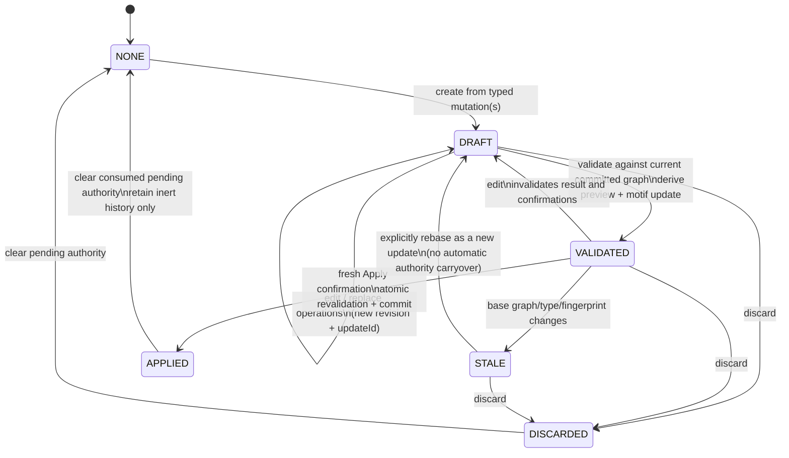
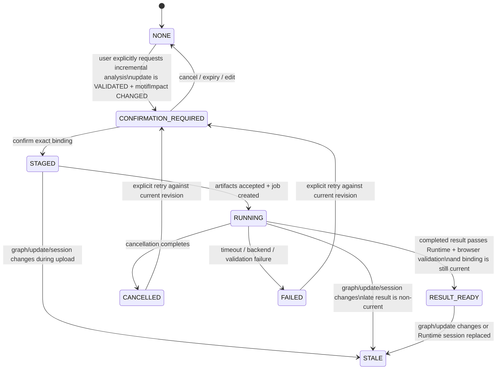

# CANDY Scope 5 state machine

## State ownership

The state machine belongs to the browser application. The Runtime owns job execution state only; a Runtime job or result never owns graph-mutation authority.

Use one `PendingDynamicHypergraphUpdate` aggregate with three orthogonal substates:

- **update state** — authoring/validation/application authority;
- **analysis state** — optional CANDY job/result lifecycle;
- **confirmation state** — short-lived exact action approval.

Keeping them orthogonal avoids the false implication that analysis is required before Apply or that a result applies an update.

## Recommended aggregate

```text
PendingDynamicHypergraphUpdate
  updateId                 fresh UUID per material revision
  revision                 monotonic browser-session integer
  status                   DRAFT | VALIDATED | STALE | APPLIED | DISCARDED
  baseGraphRef             graphId + graphVersion
  baseGraphFingerprint     UI stale-state binding
  graphType                literal DynamicHypergraph
  plan                     authoritative GraphMutationPlan
  planHash                 exact authoring/apply binding
  preview                  proposed graph and counts
  proposedGraphFingerprint exact next-state binding
  nextGraphVersion         base + 1
  motifUpdate              derived immutable DELETE_THEN_INSERT projection
  motifUpdateArtifactId    set only after upload
  motifImpact              CHANGED | NONE
  analysis                 NONE | CONFIRMATION_REQUIRED | STAGED | RUNNING |
                           RESULT_READY | FAILED | CANCELLED | STALE
  resultBinding            optional, read-only
  staleReason              optional typed reason
```

`motifUpdate` is derived data. `plan + validated preview` remain the graph-application authority.

## Update lifecycle



### Validation invariants

A transition to `VALIDATED` requires all of the following:

1. current graph type is exactly `DynamicHypergraph`;
2. `baseGraphRef`, base fingerprint, and GraphMutationPlan expected identity match current committed state;
3. preview succeeds and does not mutate committed state;
4. `nextGraphVersion === baseGraphVersion + 1`;
5. deterministic committed-versus-proposed incidence diff validates as `HypergraphMotifUpdate` with fixed ordering/collision policy;
6. proposed graph fingerprint is computed and retained;
7. qualified limits are preflighted;
8. a material edit gets a fresh `updateId`, revision, and digest.

An empty/topology-neutral motif diff may remain a valid graph update with `motifImpact: NONE`; it must never fabricate a Runtime delta. The product may display “no motif-relevant incidence change” and keep Apply independent. A full graph-content no-op should not advance the graph version and should terminate as a no-op rather than produce an authoritative pending update.

## Analysis lifecycle



Analysis state never changes update state to `APPLIED`. `RESULT_READY` means only that a signed delta is safe to present for that exact pending revision.

## Confirmation boundaries

| Boundary | Confirmation | Exact binding | Effect |
|---|---|---|---|
| Construct/edit pending update | No destructive confirmation required; explicit user edit intent is required | Current graph + typed operations; every edit creates a new revision | Changes only draft/preview state |
| Run CUDA_INCREMENTAL | Yes | graph ID/version/fingerprint/type, update ID/revision/digest, proposed fingerprint, backend/mode/device/timeout, Runtime session | Creates analysis job only |
| Apply pending update | Yes, separate action/token | graph ID/version/fingerprint/type, plan ID/hash, update ID/revision/digest, proposed fingerprint, next version | Commits graph once; does not run analysis |

Any edit, rebase, replacement, clear, undo, graph mutation, Runtime-session change, confirmation expiry, or superseding update invalidates relevant confirmation tokens. Cancellation/timeout also invalidates an already staged Apply token; applying later is allowed only after a fresh explicit Apply request, fresh validation, and fresh confirmation.

## Graph transitions

| Transition | Required result |
|---|---|
| Enable/choose DynamicHypergraph | Authority transition changes graph state token and version; never inferred from pending text |
| Apply validated update | Same graph ID, version exactly +1, content equals retained proposed fingerprint |
| Parser/dataset replacement | New graph ID, version monotonic, pending update becomes STALE then is cleared/discarded |
| Clear | New empty graph ID, version monotonic, pending update stale/cleared |
| Undo | New committed version; old pending update/result stale even if content happens to match an older snapshot |
| Preview | No graph authority/version change |

## Fail-closed race behavior

| Race | Required behavior |
|---|---|
| Graph changes during upload/job | Cancel if possible; mark job/result STALE; never display as current or apply |
| Pending update changes during upload/job | New update ID/revision/digest; cancel/supersede old job; late result rejected |
| Second update created before first completes | One authoritative pending aggregate: second revision supersedes first; old job may finish only as non-current evidence |
| User cancels job then applies | Cancellation cannot apply and invalidates old Apply confirmation. Fresh Apply may be separately authorized because application is independent of analysis |
| Runtime reconnect/session changes | All in-memory job/result bindings from old session become STALE; update may be reanalyzed after discovery |
| Browser reload during job | No job/result/apply authority is restored. Treat any persisted description as inert and stale |
| Timeout/failed native run | Pending update remains validated if graph/update are unchanged, but result is absent and Apply needs fresh confirmation |
| Late cancellation after native success | Runtime accepts no result after abort; browser also requires current binding before observation |

## Re-observation

After validate, edit, discard, submit, cancel, result acceptance, apply, failure, reload, or Runtime reconnect, rebuild the authoritative Assistant observation. It should expose only bounded selectors and status:

```json
{
  "updateId": "bounded-id",
  "revision": 3,
  "status": "VALIDATED",
  "baseGraphRef": { "graphId": "...", "graphVersion": 7 },
  "nextGraphVersion": 8,
  "motifImpact": "CHANGED",
  "operationCount": 4,
  "analysisStatus": "RESULT_READY"
}
```

Do not expose artifact bodies, memberships, request paths, native digests, credentials, or executable details to the model.

