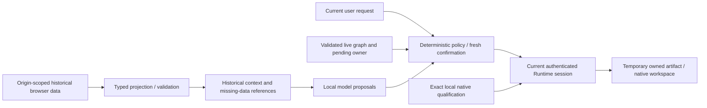

# Scope 7 — persistence security and privacy threat model

## 1. Overview

This model covers persistence/restore and prospective Scope 7 boundaries at `335c320a052eab48d3f0c2d309805d10a5918189`. It is source-backed architecture analysis, not a full repository vulnerability scan, an automated Security seal or qualification of new features. No automated Codex Security process/tool was invoked. The threat-model skill supplied the method; the user's explicit artifact-only output boundary supersedes shared-cache/plugin-state storage. No `.codex` state was changed. A fresh-context independent reviewer inspected the same boundaries offline; material claims were checked against actual consumers before assembly.

| Component / sources | Actual data flow and sensitive operation |
|---|---|
| App and graph owners | Upload bytes and graph mutations remain in React/controller memory; graph/history/pending authority initializes separately from thread history. `src/App.jsx:253`, `src/App.jsx:269`, `src/App.jsx:277`. |
| Thread persistence | Hook → queue → projected IndexedDB record → projected load → messages/summary/historical refs. No restored executable actions, pending updates, graphs, approvals/jobs/current results. `src/persistence/threadStateSchema.js:7`, `src/persistence/usePersistentThread.js:18`. |
| Parser profiles and parser worker | JSON localStorage → lightweight profile check → explicit editor Use → separate code-safety/restricted worker execution and result Apply. Thread draft recovery is display-only. `src/agent/parserProfiles.js:39`, `src/App.jsx:3878`, `src/utils/customParser.js:585`. |
| Local model | Saved preferences → disconnected initial state → explicit configured Direct/Bridge checks → selected context sent to local Ollama. Historical memory can influence model proposals; application code owns state and authorization. `src/App.jsx:230`, `src/App.jsx:2072`, `src/agent/prompts/reactOrchestratorPrompt.js:42`. |
| CANDY Runtime | Session hint → fresh authenticated discovery → graph/pending/session-bound confirmation/job/result owners. Temporary artifacts are separately constrained filesystem data. `src/candy/useCandyRuntime.js:36`, `src/candy/motifAnalysisController.js:30`, `candy-runtime/src/artifacts/ownedRoot.js:46`. |

### Effective resources, recipients and independently enforced controls

| Deployment/workflow | Resource / configuration chain | Effective value/location and readers/writers | Enforcing control / verified limitation |
|---|---|---|---|
| Combined local frontend at :5173 | Selected frontend origin → fixed IDB name / main key | `http://127.0.0.1:5173`, `hypergraph-chat-threads/threads/main`; same-origin scripts and Assistant hook. | Browser origin plus save/load projection. Not checkout/path/project isolation. `run-with-ollama.bat:49`, `src/persistence/threadStore.js:16`. |
| Fallback frontend at :5174 | :5173 occupied → launcher chooses next port | Separate browser storage namespace at `http://127.0.0.1:5174`; old :5173 history is inaccessible from it. | No migration/portability layer. Functional gap S7-01, not evidence of old data deletion. `scripts/launcher-preflight.mjs:20`, `run-with-ollama.bat:42`. |
| Localhost / Pages | Actual host/scheme/port → browser storage key; Pages base path changes routing only | `http://localhost:5173` is separate from loopback-IP origin. `https://<owner>.github.io` shares storage principal across paths on that owner origin. | No cross-origin access; no path-based confidentiality. Actual deployed owner and cohosted applications were not investigated. `.github/workflows/deploy-pages.yml:28`, `vite.config.js:7`. |
| Model settings, each origin | App lazy read/normalize, effect save | localStorage `hypergraph-local-model-settings`; App and same-origin scripts. Active transport/endpoint included as hints. | App starts disconnected and fresh Connect replaces destination. Read failures default; save failures silent. `src/agent/localModelSettings.js:165`, `src/App.jsx:231`. |
| Parser profiles, each origin | Current key, else legacy fallback | `hypergraph_converter_parser_profiles_v7_3` / `_v7_2`; code, mappings, headers/names/signatures; explicit Use/editor/worker and optional JSON download. | Lightweight storage validation is distinct from execution sandbox. Legacy key remains; same-origin access and export privacy matter. `src/agent/parserProfiles.js:39`, `src/App.jsx:3878`. |
| Direct local model recipient | Remembered attempt order → fixed endpoint → fresh model/structured check | `http://localhost:11434/api/chat`; local Ollama sees selected prompts/file previews/context. | Current connected-status gates; generic low-level client permits local/private-network endpoints, a broader policy than ordinary fixed-loopback Connect. `src/agent/ollamaConnectionManager.js:14`, `src/agent/localModelClient.js:62`. |
| Bridged model recipient | VITE_HYPERGRAPH_BRIDGE_PORT or 8787 → loopback bridge → OLLAMA_BASE_URL default | `http://127.0.0.1:<port>/ollama/api/chat`; bridge upstream defaults to `http://127.0.0.1:11434`. Operator override is restricted to HTTP(S) local/private hosts without URL credentials; public targets are rejected. | Exact bridge origin allowlist, validated upstream, redirect:error and bounded forwarding; launcher verifies service marker; App bridge health itself only fetches JSON before model checks. No cryptographic model/bridge attestation claimed. `local-runtime-bridge.js:17`, `local-runtime-bridge.js:21`, `local-runtime-bridge.js:44`, `local-runtime-bridge.js:71`, `local-runtime-bridge.js:200`, `scripts/launcher-preflight.mjs:42`, `src/agent/ollamaConnectionManager.js:94`. |
| Pairing hint and protected HTTP | Page-session key → current Authorization header | sessionStorage `hypergraph-studio.candy-runtime-token.session`; bearer credential intentionally omitted; Runtime endpoint `http://127.0.0.1:8791`. | New owner unauthorized; explicit health/schema/authenticated capability/session checks. Same bearer principal is not per-thread/tab tenant isolation. `src/candy/useCandyRuntime.js:9`, `src/candy/client.js:33`, `candy-runtime/src/auth/sessionAuth.js:7`. |
| Standard CANDY CLI | createRuntimeConfig defaults independent of combined launcher | Bind 127.0.0.1:8791; allowed origins localhost:5173, 127.0.0.1:5173, hypergraphproject.github.io. | Exact Origin checks plus bearer auth; health public, protected routes not. Selected fallback frontend :5174 is not automatically added. `candy-runtime/src/config.js:10`, `candy-runtime/src/server.js:21`, `candy-runtime/src/server.js:61`. |
| CLI temporary pairing file | first16hex SHA256(cli URL) + os.tmpdir | `<tmp>/candy-runtime-pairing-<rootKey>.txt`; operator and host-permitted filesystem principals; no contents inspected. | Random token; bounded regular stale-file checks, exclusive write, requested 0600, normal signal cleanup. Crash residue possible; effective Windows ACL privacy unverified. `candy-runtime/src/cli.js:7`, `candy-runtime/src/cli.js:10`. |
| CLI temporary artifacts | same rootKey → owned root → digest/workspace children | `<tmp>/candy-runtime-owned-<rootKey>/<digest>.artifact`, `workspaces/job-XXXXXX/request.txt`, marker/owner files. | Marker, realpath, exclusive lease, digest, byte/count quotas and constrained cleanup. Restart purges recognized old data; jobs/metadata restart empty. `candy-runtime/src/artifacts/ownedRoot.js:20`, `candy-runtime/src/artifacts/artifactStore.js:38`, `candy-runtime/src/jobs/jobManager.js:210`. |
| Library Runtime without root override | server mkdtemp, not CLI stable root | `<tmp>/candy-runtime-artifacts-*`, same child types; Runtime/native and host-permitted principals. | Normal close disposes root; CLI recovery is not evidence of scavenging abandoned random library roots. `candy-runtime/src/server.js:48`, `candy-runtime/src/server.js:120`. |
| Windows native process | companion-owned request file → drive path translation → fixed WSL executable/supervisor | Drive-letter host file becomes `/mnt/<drive>/.../request.txt`; qualified Ubuntu native process reads graph data. | Fixed executable/shell:false and exact qualification; host/WSL filesystem confidentiality remains a deployment prerequisite. `candy-runtime/src/backends/nativeProcessRunner.js:10`, `candy-runtime/src/backends/nativeProcessRunner.js:43`. |
| Native operator provenance | runtimeRoot → .local record, binary/source/Makefile/evidence/toolchain/GPU | Distinct STATIC and INCREMENTAL installation resources, not browser projects or imported workspace data. | Exact schema/hash/commit/device checks; never copy or mint qualifications from saved available flags. `candy-runtime/src/capabilities/motifQualification.js:24`, `candy-runtime/src/capabilities/motifQualification.js:37`. |

The schema map records exact current limits and the calculated normal-environment temp paths. Source requests POSIX modes and README describes mode-restricted pairing storage (`README.md:45`); this does not independently prove effective Windows ACL/WSL mount protection. No private browser database, pairing file or native installation was read to build this model.

## 2. Threat model, boundaries and assumptions

**Protected assets:** private chat/summary, filenames/headers/dataset and parser content; correct project/source/graph/result identities; retained user work; model destination privacy; Runtime bearer credential; deterministic command authority; fresh single-use confirmations; native provenance; correct Analyze/Apply separation.

**Actors:** an ordinary user; an untrusted dataset/chat/profile/workspace author; a model producing untrusted proposals; another tab holding stale data; an unrelated local listener; same-origin scripts/cohosted applications; the local Runtime/native worker; the trusted local installation/operator. A data author does not automatically have same-origin script execution, the bearer token, OS account control or fresh user approval. A host administrator/account compromise is not a new privilege escalation merely because that actor reads storage it already controls.

**Established controls:** explicit save/load projections discard unknown execution fields; restored graph availability false; pendingAction null; restored message actions empty; active graph/pending/result owners initialize separately; live graph/session/context checks and exact confirmation remain in deterministic code. Existing Context-only prompts support these controls but do not replace them. `src/persistence/threadStateSchema.js:23`, `src/candy/motifResultRegistry.js:7`, `src/candy/motifAnalysisController.js:65`, `src/agent/orchestratorObservation.js:83`.

Saved thread drafts render as text; parser profiles require explicit loading and a separate safety/execution path. Profile reuse intentionally lacks dataset batch binding unless a generated binding has batchId; it must not be mistaken for automatic safe applicability to arbitrary data. `src/components/AgentChatPanel.jsx:3053`, `src/agent/parserBinding.js:1`, `src/App.jsx:3012`.

**Invariants for future persistence:** deterministic code alone owns project revision, normalized source/graph identity, verified completed events/results and executable authority. LLM-written memory is a proposal/context field, never a database commit, authorization or actual-result assertion. Restore/import may not create pending actions/jobs, automatically run code, apply a graph change, reconnect to an arbitrary endpoint or mark native availability. No stored permission booleans/tokens are portable. Hashes establish byte integrity only, not trust in a publisher or claims made inside a manifest.

**Assumptions/unknowns:** browser profile storage is best-effort and same-origin, not encrypted application storage or a backup. Session restoration may retain/copy sessionStorage. Actual cohosted Pages applications, browser partition/eviction settings, effective Windows ACLs, external Ollama storage/logging and physical power-loss behavior were not tested. A generic local/private endpoint allowance is broader than “only this loopback process”; preserving the normal local-only workflow must not introduce an API/cloud requirement. No product-wide security coverage or automatic seal completion is claimed.

## 3. Attack surfaces, mitigations and attacker stories

These are **threat scenarios and readiness requirements**, not validated vulnerability findings. Confirmed functional gaps are identified separately by S7 IDs.

| Priority | Scenario / possible capability gain | Prerequisite | Impact | Current controls / counterevidence | Required mitigation and evidence |
|---|---|---|---|---|---|
| High design priority | Imported/history text claims previous approval, graph availability or completed job. | Attacker controls persisted/imported text or untrusted model output; a future restore/dispatcher incorrectly promotes it. | Unauthorized mutation/native computation or fabricated result. | Current projection strips authority; fresh owner/context checks and confirmations remain. No bypass demonstrated. | Persist inert data only; whitelist schema, taint/provenance, fresh exact approvals; R35/R36/R42/R49/R51. `src/persistence/threadStateSchema.js:31`, `src/candy/motifAnalysisController.js:81`. |
| High design priority | Stale tab/late save overwrites new/deleted project or mixes same-origin projects. | Two authorized tabs or cohosted application uses same keys/main; no extra remote access assumed. | Lost work, disclosure across intended projects, deletion resurrection. | Execution owners isolated, but no record CAS; P05 validates snapshot overwrite semantics with test double. | Project namespace, revision CAS/tombstones, current-owner publication, intentional conflict UX; S7-03/S7-04, R19/R40/R48/R52. `src/persistence/usePersistentThread.js:37`. |
| High design priority | Result/dataset/parser substitution on reattachment or import. | Missing file reattached by name/size or a future importer trusts metadata without bytes/provenance. | Wrong analysis, stale Apply proposal, data integrity loss. | Current refs require re-upload and graph unavailable; current live result registry binds exact session/application. | Content-addressed sources/results, typed graph/type/lineage, separate historical output adapter; S7-11/S7-14, R24–R27/R44. `src/persistence/threadStateSchema.js:11`, `src/candy/motifResultRegistry.js:7`. |
| Medium | Sensitive chat, filenames, parser strings remain after a narrow clear/forget action or are exported. | User stores sensitive content, same-origin script/profile access, or shares an export. | Confidentiality/retention exposure. | Dedicated raw source bytes omitted from thread, but arbitrary text can contain secrets; button explicitly says references. No comprehensive erase guarantee. | Explicit retention/inclusion consent, clear scope, all-key/project delete receipts, backup/download caveats; optional separately designed encryption. S7-15/R40/R50. `src/components/AgentChatPanel.jsx:2852`, `src/persistence/usePersistentThread.js:40`. |
| Medium | Stored parser/profile is malicious or stale. | A profile/import/history author controls code; user/future restore chooses it. | Attempted worker resource abuse or wrong result; broader effect needs an actual execution-control failure. | Thread draft display inert; separate safety analysis, restricted globals, timeout/output limits; no auto-run. | Strict profile schema/bounds/migration, review and current data binding, preserve sandbox and separate Apply. S7-07, R43/R54. `src/utils/customParser.js:158`, `src/utils/customParser.js:636`. |
| Medium | Stored prompt injection persists in summary or model-generated draft. | Untrusted content reaches future model context. | Model may propose misleading actions/results or leak data into local output/export. | Current ReAct context explicitly context_only; authoritative observation and deterministic authorization separate. This is not proof models ignore hostile text. | Typed factual memory, source/trust/expiry, least context, no unconstrained raw replay; test real dispatcher with hostile historical claims. S7-09/S7-10/R42. `src/agent/prompts/reactOrchestratorPrompt.js:42`, `src/agent/prompts/threadMemoryPrompt.js:2`. |
| Medium | Huge/corrupt/deep/unsupported stored input blocks hydration or exhausts quota. | Actor can provide import data or write same-origin storage; self-origin failure otherwise. | Availability/unsaved work loss. | Thread 1M-character gate, bounded fields, queue two snapshots; profile/settings weaker. No quarantine/retry. | Byte/depth/object limits before materialization, progressive parsing, migration quarantine, backpressure and last-good manifest. S7-05–S7-08/R12–R18/R39/R54. `src/persistence/threadStateSchema.js:24`, `src/agent/parserProfiles.js:104`. |
| Medium | Local port/hostname changes split history or point at an unrelated origin/bridge. | Listener conflict, explicit URL change or stale build config. | Work appears missing; wrong local responder can imitate health/model protocol. | Browser origin isolation; loopback fixed normal targets; launcher checks service marker; Runtime requires exact origins plus token. No cryptographic local-service identity claimed. | Stable origin, explicit migration, validated bridge identity/config and current liveness; no arbitrary scan/wildcard origins. S7-01/S7-12/S7-13/R09–R11/R29–R34. `scripts/launcher-preflight.mjs:42`, `candy-runtime/src/config.js:10`. |
| Medium | Crash leaves graph/request/artifact/pairing bytes on disk or a future cleanup deletes durable projects. | Owned process crashes; host-permitted actor reads residue; or project data wrongly shares temporary root. | Confidentiality or permanent work loss. | Constrained stable-root reconciliation and normal cleanup; library random-root and effective ACL caveats remain. | Distinct durable project root/API; explicit retention/scavenging policy, measured ACLs; never place native records or durable projects in purgeable root. S7-14/S7-15/R28/R38/R40. `candy-runtime/src/artifacts/ownedRoot.js:46`. |
| Conditional | XSS executes in app origin and reads browser storage/bearer hint. | An independent same-origin script-execution weakness or compromised cohost exists. | Private history/profile access and Runtime token use under that principal. | Inspected thread recovery uses React text/pre rendering; no stored-XSS path validated. Origin keys are not security isolation from scripts sharing that origin. | Preserve text rendering, parser restrictions, minimal stored secrets, origin separation and threat-specific tests; do not claim encryption defeats a running compromised page. R41/R48/R51. `src/components/AgentChatPanel.jsx:3053`, `src/candy/useCandyRuntime.js:14`. |
| Conditional | Downgrade/future schema normalized into a destructive old writer. | Old bundle/attacker-supplied version fields and a future migration path accepts them. | Silent loss or authority field confusion. | Thread rejects >1; settings/profile migration does not have equivalent strict version rejection. | Explicit schema floors, CAS and read-only incompatibility; never reinterpret unknown objects as current authority. S7-05/S7-07/R18/R45/R54. `src/agent/localModelSettings.js:99`, `src/agent/parserProfiles.js:139`. |

Unsafe JSON deserialization is modeled as validation/resource risk; JSON.parse does not itself execute parser code. Plain-object projection is a useful control, not proof that all future object merges/renderers/importers are safe. Likewise a stale artifact id alone is not a credential: protected reads still require the token and current metadata. Unknown attacker prerequisites remain questions rather than invented exploits.

## 4. Severity calibration and acceptance boundary

**Critical:** reserved for independently established broad remote compromise or similarly exceptional impact/reachability. No such finding established here. A hypothetical future restore-to-code execution path cannot be counted Critical without an actual reachable control failure.

**High:** a demonstrated serious authority bypass or broad work loss under normal reachable workflows could qualify. The gap register's three High entries are **functional continuity/data-integrity planning priorities**, not three security vulnerabilities. Existing saved approvals are stripped; do not report a replay flaw from attacker text alone.

**Medium:** bounded continuity, recovery, corruption, privacy-retention and migration gaps with realistic user impact; a security scenario also needs a concrete new capability and prerequisites. Same-origin write access or explicit import affects reachability and should be stated. The controlled probes establish current behaviors, not remote attacker access.

**Low:** misleading naming/diagnostics or loss of non-authoritative UI preferences without material integrity/authorization impact. Scope 7 must still fix clarity and freshness semantics without treating a stored status label as permission.

Open qualification questions: real-browser durability/fault timing, effective Windows/WSL ACLs, cross-origin export UX and same-owner Pages deployment policy, storage budget measurements, migration/deletion behavior under stale tabs, and actual local service identity/freshness after restarts. The restart plan defines acceptance tests. None is silently waived by the frozen v7.3.15 release, the earlier accepted automated-seal infrastructure exception, or this readiness verdict.

Repository: C:\Users\tharu\OneDrive\Documents\Candi\hypergraph-converter-v7.3.15-scope7-readiness
Version: 335c320a052eab48d3f0c2d309805d10a5918189
