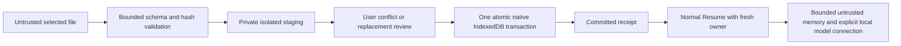

# Scope 8A portability threat model

Product baseline: `1d4c3b0659e39ae015f8e85888a1f0f68b14cecf`.
Reviewed proposed-source snapshot: `7194025eaa319fad20dc1daa0b948d875f5d735b1711b4f26d444ba6b8f42a99`.
Scope: workspace file export, parsing/staging, conflict review, atomic import and ordinary Resume. This is a sequential source-backed review, not an independent delegated assessment or automated security seal. User-mandated artifact paths override the skill's managed plugin-state destination; no shared threat-model cache or `.codex` state is read/written for this review.

## Overview

Users explicitly select/export a local durable project or explicitly select an untrusted portability file. The application validates an uncompressed, canonical container into private memory before any durable write. Import as a new local project is the default; replacement requires a current owner token and confirmation. A single native transaction publishes the complete data and normal Resume creates a fresh mounted owner.

| Component | Effective resource/capability | Enforcing source |
| --- | --- | --- |
| Workspace controls | Explicit file chooser and download; no filesystem extraction or process execution | `src/components/WorkspacePortabilityPanel.jsx:19`, `src/components/WorkspacePortabilityPanel.jsx:26` |
| Container boundary | 48 MiB encoded file, 32 MiB decoded budget, at most 156 canonical UUID payload paths; no compression | `src/persistence/workspacePortability.js:14`, `src/persistence/workspacePortability.js:106` |
| Staging | Private WeakMap data; public review handle cannot substitute payloads or destination authority | `src/persistence/workspacePortability.js:16`, `src/persistence/workspacePortability.js:149` |
| Data integrity / restoration | Object/root/memory SHA-256, schema, graph/source relations and application metadata, including checkpoint-specific source references | `src/persistence/workspacePortability.js:45`, `src/persistence/workspaceCapture.js:38` |
| Durable publication | Browser-origin `hypergraph-studio-projects` database; project, root, objects, memory, authority-free chat, selection/name and eligible model profile in one transaction | `src/persistence/projectSchema.js:4`, `src/persistence/projectStore.js:365` |
| Receipt | Native transaction completion; request success does not acknowledge durability | `src/persistence/projectStore.js:43`, `src/persistence/projectStore.js:50` |
| Replacement authority | Active project/key, one-use owner review, exact local revision, explicit modal; old mount invalidated after commit | `src/components/WorkspaceExperience.jsx:51`, `src/persistence/projectSession.js:67` |
| Memory / model consumer | Imported, unverified, bounded project context; approved credential-free loopback preference, reconnect OFF unless retaining existing user intent | `src/persistence/workspacePortability.js:157`, `src/persistence/assistantMemoryRetrieval.js:16`, `src/persistence/modelConnectionSchema.js:7`, `src/persistence/projectStore.js:414` |

## Threat model, trust boundaries and assumptions

**Assets:** acknowledged durable source/graph bytes, verified provenance, existing projects and tombstones, bounded project memory, manual reconnect intent, local-only model routing, and non-persistent mutation authority.

**Attacker capabilities:** supply all file bytes, names, extension/MIME type, payload identifiers, hashes and model/memory claims; persuade a user to open a file; race with another existing same-origin tab; corrupt supported stored data in a test. A file author does not thereby control application JavaScript, the operator account, browser origin, active owner token or explicit confirmation. An arbitrary same-origin script already has IndexedDB authority and is not isolated by this file format.

**Boundaries and objectives:** untrusted bytes must pass size/format/canonical JSON/schema/object checks before staging; staged data must not grant writer authority; local project identities/revisions are minted independently; replacement must bind the reviewed archive handle and current destination; partial publication must roll back every category; a committed receipt must wait for native completion; unrelated projects stay intact; memory cannot authorize actions; imported model settings cannot widen network origin, carry credentials or resurrect a saved connection callback.

**Assumptions / limits:** SHA-256 provides integrity, not sender authentication. Users review source content before sharing; recognizable secret material is refused, but arbitrary secrets disguised in user data cannot be semantically identified with certainty. A corrupted/missing existing default selection is preserved rather than silently repaired. Compressed containers, arbitrary archive extraction, cloud storage/synchronization and Scope 8B are unsupported. Native final browser coverage is isolated Chrome on this Windows installation; it is not machine power removal, physical disk exhaustion or a cross-platform browser reliability claim. Test-only crash timing hooks are guarded fixtures, not application entry points.

## Attack surface, mitigations and attacker stories

These are attack scenarios, not a list of discovered vulnerabilities. Final disposition is recorded separately in qualification/security evidence.

| Priority | Scenario / capability gain | Prerequisites and impact | Existing control / mitigation | Evidence |
| --- | --- | --- | --- | --- |
| High | Traversal, aliases, duplicate names or compression bomb gains filesystem access/resource expansion | Victim selects hostile file | Magic rejected before decode/decompression; no inflater/extractor; strict bounded `objects/<UUID>.bin` namespace; duplicate and unreferenced names refused | `src/persistence/workspacePortability.js:106` |
| High | Hash substitution or manifest/payload mismatch publishes corrupt source/graph | Attacker can recompute outer hashes | Every binary length/digest and exact header is checked; semantic graph/source/schema checks remain necessary even for self-consistent hashes | `src/persistence/workspacePortability.js:45` |
| High | Oversize/deep JSON or base64 overwhelms parser | Deliberately selected hostile input | Pre-read Blob/byte size limit, bounded JSON/copy, aggregate/header limits, nonrecursive base64 check plus canonical decode comparison; valid 8 MiB regression | `src/persistence/workspacePortability.js:15`, `src/persistence/workspacePortability.js:29` |
| High | Foreign project ID or archive revision overwrites B or resurrects stale authority | Existing local project or stale tab | Default fresh local UUID, independent local next revision, project-scoped IDs, exact CAS, tombstones; original identity only provenance | `src/persistence/projectStore.js:365`, `src/persistence/projectSession.js:67` |
| High | Replay rolls back edited/deleted imported project | Same file is selected again | Exact-file lineage conflict policy scans retained project/tombstone lineage; full bounded lineage is refused rather than evicted | `src/persistence/projectStore.js:379` |
| High | Review-to-publication race swaps destination or stale confirmation | User switches project or concurrent writer | One-use category/project token, active key and exact revision; shared owner invalidated after replacement so queued old saves cannot overwrite import | `src/components/WorkspaceExperience.jsx:55`, `src/persistence/projectSession.js:67` |
| High | Crash or quota publishes half a workspace or false success | Interruption during write / callback | One transaction over all categories, active-owner checks before publication, rollback on abort; completion acknowledgement only | `src/persistence/projectStore.js:43`, `src/persistence/projectStore.js:365` |
| High | Parser/CUDA/Apply command or approval field executes on Resume | Malicious manifest, graph or metadata | Strict control/data schemas, authority-free chat, normal Resume resets actions/parser results and invalidates Apply; parser source remains reviewed data | `src/persistence/workspacePortability.js:45`, `src/persistence/projectStore.js:410`, `src/App.jsx:378` |
| High | Stored prompt injection or malicious memory crosses from data to command authority | User imports instruction-like memory | Verified bounded envelope, active rows only, forced IMPORTED/UNVERIFIED provenance; qualified untrusted recall and deterministic confirmations remain independent | `src/persistence/workspacePortability.js:157`, `src/persistence/assistantMemoryRetrieval.js:16` |
| High | Credential/endpoint injection exports secrets or connects remotely | Hostile model/profile/control fields | Strict preference allowlist, credential-free approved loopback URLs, recognizable secret checks on payloads/metadata, imported reconnect OFF; existing global intent retained | `src/persistence/workspacePortability.js:21`, `src/persistence/workspacePortability.js:40`, `src/persistence/modelConnectionSchema.js:7` |
| Medium | Prototype pollution / malformed, future or incomplete schema appears valid | Untrusted JSON / schema claims | Bounded plain-data validation rejects unsafe keys; strict allowed fields and future-version errors; explicit v1 migration before staging | `src/persistence/storageSafety.js:29`, `src/persistence/workspacePortability.js:106` |
| Medium | Imported preference overwrites another project's global model intent | Existing configuration / explicit forgotten state | Only revision-zero absent model state can receive safe OFF selection; nonzero existing/forgotten record retained with CAS | `src/persistence/projectStore.js:414` |
| Medium | Fault hook becomes production backdoor | Production imports test fixture | Hooks are in guarded test entry, absent from application import graph/build; temporary server/controller stay in excluded work directory | `tests/fixtures/candy-scope8a-browser.mjs:3`, `src/components/WorkspaceExperience.jsx:6` |

## Severity calibration

- **Critical:** automatic arbitrary process/code execution or broad credential exfiltration from merely opening a file, if a real source-to-sink path bypassed sandbox/confirmation. The implementation has no archive extractor, process launcher or automatic parser/CUDA execution path here; such a claim requires new evidence.
- **High:** unauthorized cross-project destruction/replacement, resurrection of stale mutation authority, or acknowledged state missing after native commit. Explicitly confirmed replacement of the named current project is authorized behavior, not such a finding.
- **Medium:** persistence-integrity/availability failures for supported valid files, resource amplification outside established limits, or rollback confusion that threatens restoration. The development checkpoint-reference, digit-slot and large-base64 defects were reproduced and corrected before final qualification; they are not waived.
- **Low:** bounded presentation/documentation issues without authority or durable-data impact. A correctly rejected incompatible or corrupted file is fail-closed behavior, not a vulnerability by itself.

There is no automatic security-seal claim. Runtime credentials, native/CUDA algorithms and main/tag history remain outside the implementation delta and protected by baseline/source-diff checks.

## Final resource-boundary review

The final snapshot adds two guards without changing exported data bytes. Credential screening normalizes whitespace in its temporary scanning copy before applying the qualified memory checker. The bounded pre-fix diagnostic timed out on a credential keyword followed by long whitespace (`candy-scope8a-work/secret-scan-whitespace-red.json`); the final eight-MiB whitespace/source regression exercises the corrected codec.

Application metadata references are counted and their expanded byte lengths are summed before `decodeWorkspaceInputs` materializes text/Blob values (`src/persistence/workspacePortability.js:62`, `src/persistence/workspacePortability.js:70`). Each checkpoint allows at most 156 references and 64 MiB of expanded references. The test-only pre-fix allocation counter observed 1001 Blob constructions from a one-KiB source plus 1000 metadata references; extrapolation to an allowed eight-MiB source would request over eight GiB. This was a controlled counter, not an actual browser out-of-memory experiment. The final adversarial regression rejects both the expanded-byte and reference-count variants before application materialization.

Both scoped availability issues were corrected before the final snapshot and are closed Medium findings, not accepted exceptions. The prior preliminary threat model and all diagnostic failures remain preserved. Final source/extracted/browser results and the final manual security disposition are recorded separately; this document does not claim an automated scan or seal.

The final UI handoff also preserves the qualified unsaved-edit review: import as a separate workspace requires Cancel-first confirmation before leaving unsaved current edits. The native browser matrix separately induces a guarded write failure to retain unsaved edits and verifies Cancel preserves both local text and current project without any import publication. This is an injected storage failure in a real native browser, not actual disk exhaustion.
