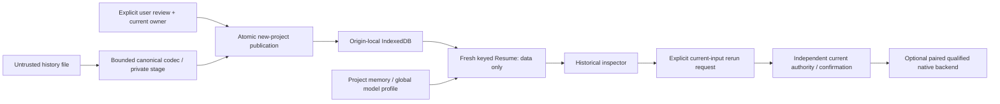

# Scope 8C proposed-feature threat model

## 1. Overview

Scoped source-based architecture/readiness model at `4237de4c768daa98f81536423e9bf6ff787f09ce`; not a scan completion or vulnerability finding report. Independent fresh-context review was required by the threat-model skill and retained unchanged under `artifacts/candy-scope8c-work/independent-architecture-review.json` (SHA256 f5b48585767a2888b96a357ec92207c9e71261289448dcbd33be88b21f35c7ac). Parent reviewed actual consumers and retained 197 independently referenced source anchors; the final citation check also covers this document. User-designated evidence paths take precedence over shared cache storage; no shared Security cache or .codex state is written.

| Component | Source | Role |
| --- | --- | --- |
| Project persistence | src/persistence/projectSchema.js:3; src/persistence/projectStore.js:15; src/persistence/projectStore.js:51; src/persistence/projectSession.js:29 | Origin-local IndexedDB v5; exact schema and project tombstones; shared CAS plus same-owner acknowledged lineage; native transaction completion is the committed receipt. Projects cap 80, lineage 32. |
| Durable source/graph | src/persistence/workspaceObjectSchema.js:18; src/persistence/storageBudget.js:3; src/persistence/projectStore.js:86 | Objects use projectId/objectId; owner, bytes, SHA and graph mapping provenance are checked. Source/graph 8 MiB each, project 32 MiB, application workspace/history 128 MiB, 24 sources, five checkpoints. |
| Resume/lifecycle | src/persistence/workspaceResumeCoordinator.js:25; src/persistence/workspaceResumeCoordinator.js:38; src/persistence/projectStore.js:79; src/persistence/projectStore.js:190 | Independent category validation includes history; history alone makes a project saved. Each mount obtains a keyed fresh owner. Workspace-only deletion retains history/memory; whole-project deletion removes durable history. |
| Full-workspace portability | src/persistence/workspacePortability.js:95; src/persistence/workspacePortability.js:111; src/persistence/projectStore.js:423; src/persistence/projectStore.js:438 | Explicit bounded canonical uncompressed files: legacy v1/v2 accepted, v2 history-free exports, v3 history-bearing exports. Root is required even when history exists. Private staged handles, validated digest/payloads, rebased imported data, atomic publication. |
| Full-workspace import identity | src/persistence/projectStore.js:440; src/persistence/projectStore.js:450; src/persistence/projectStore.js:457; src/persistence/analysisHistorySchema.js:126 | New destination project uses fresh random newProjectId(); record IDs remint deterministically relative to that destination. A portable/digest/source-project lineage marker rejects duplicate file replay. Existing-target replacement has separate reviewed CAS. |
| CPU lifecycle | src/algorithms/registry.js:13; src/hooks/useAlgorithms.js:58; src/hooks/useAlgorithms.js:75; src/hooks/useAlgorithms.js:86 | Six synchronous browser families: connected components, BFS, DFS, Dijkstra shortest path, degree distribution, k-core. Live recomputation is separate from explicit run UUID admission; finalHes can be preview input rather than published graph. |
| Native lifecycle | src/candy/motifAnalysisController.js:164; src/candy/useCandyRuntime.js:145; src/candy/useCandyRuntime.js:149; src/persistence/analysisHistorySchema.js:57 | Optional default-disabled paired companion validates current result in volatile registry before detached history. STATIC and INCREMENTAL remain distinct; history never contains pending update/job/client/token capabilities. Ordinary native SSSP cannot obtain an implicit projection from the current hypergraph UI. |
| History schema/retention | src/persistence/analysisHistorySchema.js:8; src/persistence/analysisHistorySchema.js:113; src/persistence/projectStore.js:270; src/persistence/projectStore.js:282 | Schema 1, 24 retained records, 256 KiB per record, 2 MiB per project envelope including private seen ledger, 8 MiB application history; 512 lifetime identities. Oldest completedAt/UUID eviction; delete/clear/eviction retains ledger. Full ledger refuses new identities. |
| History inspector/rerun | src/components/AnalysisHistoryPanel.jsx:18; src/components/AnalysisHistoryPanel.jsx:25; src/components/AnalysisHistoryPanel.jsx:30; src/App.jsx:3824; src/App.jsx:3842 | Plain React text/JSON, historical input/backend/origin labels. Current input digest must match; CPU gets fresh explicit run; STATIC enters current safe confirmation path; INCREMENTAL requires recreated pending update. No automatic rerun. |
| Historical provenance limits | src/persistence/analysisHistorySchema.js:138; src/persistence/analysisHistorySchema.js:10; src/algorithms/kCore.js:114 | sourceDigest is null; imported origin is unverified, graph ID/version is descriptive, SHA proves content consistency rather than computation. K-core usage.elapsedMs participates in retained payload, so resultSha256 is not universal semantic rerun equality. |
| Assistant memory | src/persistence/assistantMemorySchema.js:9; src/persistence/assistantMemoryRetrieval.js:6; src/persistence/assistantMemoryRetrieval.js:24; src/agent/modelPromptBuilder.js:277 | Project-scoped 100 records/32 active/256 KiB; recall eight items, two per type, 6000 characters. Stale/conflict exclusion and untrusted_context_only. History is not automatic memory or an instruction source. |
| Model reconnect | src/App.jsx:397; src/persistence/modelConnectionSchema.js:5; src/agent/modelConnectionProbe.js:5; src/agent/modelReconnectCoordinator.js:28 | Application-wide local-ollama profile has separate CAS/lease. Fresh bounded tags discovery after workspace/memory readiness, four attempts and bounded monitoring; durable OFF/tombstone respected. No inference/process startup from connectivity probing. |
| Project/tab isolation | src/persistence/projectSession.js:43; src/persistence/workspaceResumeCoordinator.js:93; src/components/WorkspaceExperience.jsx:39; src/persistence/projectStore.js:292 | Keyed owner generation, project CAS, exact one-use reviewed delete command, retained tombstones; foreign readback is not writable authority. Broadcast hints cause stale/reload, not silent ownership adoption. Unsaved navigation requires confirmation. |
| Recovery/status gaps | src/persistence/analysisHistoryCoordinator.js:16; src/persistence/workspaceResumeCoordinator.js:39; src/components/ResumeWorkspacePanel.jsx:26; src/components/ResumeWorkspacePanel.jsx:35; src/components/WorkspacePortabilityPanel.jsx:46 | Corrupt envelopes fail closed without salvage. Resume discovery computes historyCount/historyError but current categories omit history. Deletion text omits history retained by workspace-only clearing. Export workspace is enabled for selected project but explicitly fails when root is missing. |



Effective resource table: source facts below concern current implementation, not proposed resources already implemented.

| Deployment or workflow | Resource or capability | Configuration and precedence | Safe effective value or location | Readers, writers, or recipients | Enforcing control | Evidence or unknowns |
| --- | --- | --- | --- | --- | --- | --- |
| Browser at each distinct frontend origin | ProjectStore and project-bound persistence consumers | createProjectStore(globalThis.indexedDB, PROJECT_DATABASE) -> indexedDB.open(databaseName, PROJECT_DATABASE_VERSION) | Origin-local IndexedDB hypergraph-studio-projects v5; project-keyed stores projects/threads/workspaceRoots/assistantMemories/analysisHistories; workspaceObjects keyed <projectId>/<objectId>; meta/migrations/quarantine/modelConnections use id. | Mounted browser project owners and other same-origin application tabs | Exact owner/schema validation, shared project CAS, serialized local writer lineage, transactional publication and oncomplete receipts | src/persistence/projectSchema.js:3; src/persistence/projectStore.js:15; src/persistence/projectStore.js:17; src/persistence/projectStore.js:27; src/persistence/projectStore.js:44; src/persistence/projectSession.js:29;   Cross-origin access, remote synchronization or multi-user tenant exposure is not established. |
| Browser startup, auto-resume, explicit Resume/fresh/reload | Resume preferences and mounted session selection | meta/workspace-resume -> validated preferences -> inspect selected/default project -> new keyed createResumeProjectSession | autoResume defaults true; selectedProjectId defaults null; project labels and display preferences are application-level; each mounted Scene is keyed by a fresh active owner key. | Workspace startup UI and selected project mount | Preference CAS, generation checks, separate category validation, current project revision captured before mount | src/persistence/resumePreferenceSchema.js:4; src/persistence/workspaceResumeCoordinator.js:25; src/persistence/workspaceResumeCoordinator.js:63; src/persistence/workspaceResumeCoordinator.js:73; src/components/WorkspaceExperience.jsx:72;    |
| Browser save/restore/checkpoint recovery | Durable workspace/source/graph store | App workspace capture -> prepareWorkspace -> project-prefixed objects/root -> publishDurable -> validateWorkspaceData -> App restore | 8 MiB source and graph limits, 32 MiB project workspace, 128 MiB application workspace/history, 24 sources, five checkpoints; old checkpoints evict to fit count/bytes. | Current project parser-review UI, source editors, graph state and provenance inspection | Actual-byte SHA256/length/type/ownership validation; graph fingerprint/source binding; partial source-only restore is read-only | src/persistence/storageBudget.js:3; src/persistence/workspaceObjectSchema.js:94; src/persistence/workspaceObjectSchema.js:132; src/persistence/workspaceObjectSchema.js:141; src/persistence/workspaceRestore.js:25; src/App.jsx:381;    |
| Browser explicit CPU completion or accepted native motif completion | Analysis history persistence | Explicit operation event -> historyCompletionRecord -> projectSession.mutateAnalysisHistory -> projectStore transaction | analysisHistories[projectId]; 24 retained records, 256 KiB/record, 2 MiB/project, 8 MiB application, 512 completion ledger entries. Oldest completedAt then recordId evicts first; ledger survives delete/clear/eviction. | Project history panel and portable exporter | Strict plain-data contracts and digest validation, owner/context checks, project CAS, atomic byte/count admission, no workspace/memory eviction | src/persistence/analysisHistorySchema.js:8; src/persistence/analysisHistorySchema.js:72; src/persistence/analysisHistoryCoordinator.js:24; src/persistence/projectStore.js:257; src/persistence/projectStore.js:86; History is detached evidence, not authenticated backend or restored execution authority. None  |
| User-selected local file and browser download; separate project or reviewed replacement | Portable workspace exporter/importer | readPortableSnapshot -> validated export; selected Blob -> canonical bounded decoder -> WeakMap stage -> local owner/revision rebase -> atomic import publication | Uncompressed CANDY-WORKSPACE container, maximum 48 MiB, payload budget 32 MiB, 156 payloads/references; manifest v2 without history or v3 with history; v1/v2 import supported. Download filename candy-workspace-<projectId>.candy-workspace. | User-controlled destination file and selected local project | Canonical JSON/base64/paths, exact fields and hashes, stage object identity, explicit stale-safe replacement review, destination replay-ledger merge, imported/unverified history and reconnect-OFF profile | src/persistence/workspacePortability.js:15; src/persistence/workspacePortability.js:95; src/persistence/workspacePortability.js:111; src/persistence/workspacePortability.js:155; src/persistence/workspacePortability.js:159; src/persistence/projectStore.js:438; src/components/WorkspaceExperience.jsx:52; A saved workspace root remains required; history-only projects can Resume but cannot export an absent workspace. Old launcher text still calls cross-origin export/import deferred: run-with-ollama.bat:52. History-only portability is a candidate feature requiring its own container/publication contract, not an existing security defect. |
| Browser project context -> explicit local-model request | Assistant memory recall and model prompt | assistantMemories[projectId] -> verified workspace binding -> stale/conflict filtering -> bounded recall -> normalizeMemoryContext -> modelPromptBuilder | 100 records, 32 active, 256 KiB/project; recall at most eight items/two per type/6000 characters, authority=untrusted_context_only | Assistant UI and selected Ollama service during a real request | Project ownership, memory envelope/content hashes, explicit mutation provenance, current-workspace binding and quoted-data policy | src/persistence/assistantMemorySchema.js:9; src/persistence/assistantMemoryCoordinator.js:8; src/persistence/assistantMemoryRetrieval.js:14; src/persistence/assistantMemorySafety.js:3; src/agent/modelPromptBuilder.js:293;    |
| Browser application-wide profile, initialized after workspace/memory restore | Persistent local-model reconnect | modelConnections/local-ollama -> profile validation -> direct exact loopback or build-configured bridge -> fresh GET /api/tags | http://localhost:11434/api/tags, http://127.0.0.1:11434/api/tags, or http://127.0.0.1:<VITE_HYPERGRAPH_BRIDGE_PORT or 8787>/ollama/api/tags; 4 s probe, four attempts, 1.5/5/12 s delays, 30 s success monitor, six-second shared lease | Selected local Ollama endpoint or configured loopback bridge; no conversation/memory is sent by discovery | Exact credential-free endpoint allowlist, redirect:error, credentials:omit, model inventory/response bounds, fresh generation checks, separate profile CAS and lease | src/persistence/modelConnectionSchema.js:5; src/persistence/modelConnectionSchema.js:8; src/agent/ollamaConnectionManager.js:16; src/agent/modelConnectionProbe.js:18; src/agent/modelReconnectCoordinator.js:28; src/agent/modelReconnectCoordinator.js:45; src/App.jsx:397;    |
| Browser localStorage, separate from reconnect profile | General model preferences adapter | hypergraph-studio.settings.v1; legacy input-only hypergraph-local-model-settings -> bounded adapter -> App public/default preference projection | Numeric generation preferences and public defaults; current selected connection is stored in IndexedDB profile, while App persists recommended model plus cleared active endpoint/transport hints here | Current origin's browser app | Bounded schema, migration lineage and deletion marker; adapter explicitly does not provide same-origin CAS | src/agent/localModelSettings.js:46; src/agent/localModelSettings.js:168; src/agent/localModelSettings.js:194; src/App.jsx:415; src/persistence/localStorageAdapter.js:72;   Do not generalize IndexedDB project CAS guarantees to this localStorage adapter. |
| Raw node local-runtime-bridge.js or OS bridge/with-Ollama launchers | Ollama bridge | HYPERGRAPH_BRIDGE_HOST default 127.0.0.1; HYPERGRAPH_BRIDGE_PORT default 8787; origins precedence HYPERGRAPH_BRIDGE_ORIGINS > HYPERGRAPH_FRONTEND_ORIGIN > GitHub Pages origin; launchers supply selected frontend origins; OLLAMA_BASE_URL default http://127.0.0.1:11434 | Browser-facing /health, /ollama/api/tags and /ollama/api/chat; upstream only corresponding /api/tags or /api/chat at configured local/private target; default 5 MiB body, 60 s upstream deadline, 25 MiB response | Approved browser origins and originless callers; operator-configured Ollama service | Exact origin and route allowlists, public-target refusal, no forwarded arbitrary route, redirect rejection and bounded proxying | local-runtime-bridge.js:16; local-runtime-bridge.js:44; local-runtime-bridge.js:54; local-runtime-bridge.js:71; local-runtime-bridge.js:198; local-runtime-bridge.js:236; run-local-runtime-bridge.bat:13; run-with-ollama.sh:40;   Non-loopback bind is operator-configurable; actual remote reachability and host firewall policy were not established. |
| Optional browser integration plus npm run candy:runtime | CANDY HTTP API and pairing | VITE_CANDY_RUNTIME_ENABLED -> default client URL http://127.0.0.1:8791; createRuntimeConfig fixes bind host; CLI creates fresh token and writes temp pairing file | Loopback 127.0.0.1:8791, explicit localhost/127.0.0.1:5173 and GitHub Pages origins; public health, shared bearer-protected capability/artifact/job/result/cancel routes. Pairing hint uses sessionStorage key hypergraph-studio.candy-runtime-token.session. | Explicitly paired browser clients and any caller already possessing the session token | Fresh unauthorized browser owner, explicit discovery, token separate from URL, timingSafeEqual bearer check and exact browser-origin check | src/candy/featureFlag.js:1; src/candy/useCandyRuntime.js:9; src/candy/useCandyRuntime.js:35; src/candy/client.js:26; candy-runtime/src/config.js:10; candy-runtime/src/config.js:39; candy-runtime/src/auth/sessionAuth.js:7; candy-runtime/src/server.js:21;   This is shared local companion authority, not per-project server authorization or a remote multi-tenant deployment. |
| CLI startup versus direct startCandyRuntime() startup | Companion artifact and native request storage | CLI: tmpdir()/candy-runtime-owned-<first16 SHA256(import.meta.url)> override; library default: mkdtemp(tmpdir()/candy-runtime-artifacts-); artifact digest children and workspaces/job-XXXXXX/request.txt | CLI pairing file is tmpdir()/candy-runtime-pairing-<same rootKey>.txt, requested 0600. Artifacts are <root>/<64-lowercase-hex>.artifact; requests are <root>/workspaces/job-XXXXXX/request.txt. CLI override root is stable per installed CLI path, while default library root is fresh. | Companion process, controlled native child, and local OS principal with effective filesystem access | Marked private root, exclusive kernel lease before recovery, regular-file/symlink/realpath checks, content digest validation, bounded artifacts, constrained cleanup and no recovered session authority | candy-runtime/src/cli.js:7; candy-runtime/src/server.js:51; candy-runtime/src/artifacts/artifactStore.js:40; candy-runtime/src/artifacts/ownedRoot.js:18; candy-runtime/src/artifacts/ownedRoot.js:56; candy-runtime/src/artifacts/ownedRoot.js:79; candy-runtime/src/jobs/jobManager.js:208; candy-runtime/README.md:32 says Ctrl+C removes artifact directory. Stable CLI override close releases ownership but retains root/files; fresh library root is disposed. Recognized stale files are reconciled on next owned-root initialization. Actual OS temporary-directory mapping and Windows ACLs require deployment evidence; mode declarations alone do not prove cross-user isolation. |
| Windows Ubuntu WSL2 CUDA or Linux CUDA | Qualified native motif executor | runtimeRoot from source URL -> backend-specific MOTIF_SPECS -> qualification record + exact source/Makefile/binary/evidence hashes + qualification Git tag + device/toolchain probes -> fixed supervisor spawn | STATIC: <repo>/candy-runtime/native/hypergraph-motif-cuda/build/candy-hypergraph-motif-cuda, record .local/cuda_static-qualified-build.json. INCREMENTAL: <repo>/candy-runtime/native/hypergraph-motif-cuda-incremental-scope6d-tranche1-f3fa7dc3/build/candy-hypergraph-motif-cuda-incremental, record .local/cuda_incremental-scope6d-tranche1-f3fa7dc3-qualified-build.json. Fixed compiler probe /usr/local/cuda-13.4/bin/nvcc and runtime version file /usr/local/cuda-13.4/version.json; Windows runs wsl.exe -d Ubuntu with drive paths mapped under /mnt/<drive>. | Exact qualified executable and device selected by current request; stdout/stderr return to validated runtime adapter | No HTTP/model-supplied executable path, regular bounded qualification files, exact hashes/tag/device/toolchain, shell:false, fixed supervisor, bounded output/time and process-group cancellation | candy-runtime/src/config.js:37; candy-runtime/src/capabilities/motifQualification.js:11; candy-runtime/src/capabilities/motifQualification.js:23; candy-runtime/src/capabilities/motifQualification.js:42; candy-runtime/src/backends/nativeProcessRunner.js:10; candy-runtime/src/backends/nativeProcessRunner.js:21; candy-runtime/src/backends/nativeProcessRunner.js:43; candy-runtime/README.md:23 names generic incremental source directory. Actual incremental runtime consumes the versioned local qualification installation. It is intentionally excluded from portable source and absent in inspected local native directory inventory. Availability requires separately installed qualified local artifacts and matching hardware/toolchain. No native executable or environment probe was run. |
| One companion session shared across paired clients | Native job and artifact retention | Runtime DEFAULT_LIMITS -> JobManager admission/FIFO lane -> terminal retention -> artifact owner release | 256 maximum jobs, 16 active admission, 32 terminal jobs/16 MiB serialized terminal state, 512 artifacts/64 MiB total, four concurrent HTTP operations, 60 s queue and 120 s whole-job deadline; execution uses one bounded FIFO lane. | Current companion session's authorized clients | Bounded admission, in-flight motif deduplication, unpublish job lookup before releasing files, immutable artifact ownership/pinning and explicit unknown/expired handles | candy-runtime/src/config.js:16; candy-runtime/src/jobs/jobManager.js:127; candy-runtime/src/jobs/jobManager.js:138; candy-runtime/src/jobs/jobManager.js:176;   Companion retention is separate from durable project history and does not provide durable archived native handles. |

## 2. Threat Model, Trust Boundaries, and Assumptions

The six-field canonical model below starts from the independent review. The effective-resource rows are incorporated into its assets, retaining concrete values, controls and discrepancies rather than reducing the model to subsystem labels. Parent-selected additions are explicitly proposed.

```json
{
  "summary": "Generated architecture model for proposed Scope8C scope definition only, against the parent-supplied immutable baseline 4237de4c768daa98f81536423e9bf6ff787f09ce. Hypergraph Converter Studio is a React/Vite browser application with origin-local IndexedDB project persistence, durable source/graph checkpoints, Assistant memory, application-wide local-model connection preferences, and detached analysis history. CPU algorithms execute in the browser. Optional CUDA_STATIC and CUDA_INCREMENTAL motif analysis uses an explicitly paired loopback Node companion, qualified fixed native executables, immutable artifacts and volatile job/result authority. Resume reconstructs validated data; history inspection does not reconstruct execution authority. Scope8C has no selected feature or implementation. Evidence: package.json:10; src/persistence/projectSchema.js:3; src/persistence/projectStore.js:15; src/App.jsx:381; src/App.jsx:3753; src/hooks/useAlgorithms.js:75; src/candy/useCandyRuntime.js:35; candy-runtime/src/server.js:48. Parent readiness selection: proposed Scope8C is standalone history portability, independently versioned wire schema1 and new-project-only import. No implementation is present.",
  "assets": [
    "Project ownership, shared CAS revision lineage, identity tombstones, transaction-completion receipts, and isolation of source/graph/chat/memory/history between mounted project owners. IndexedDB database hypergraph-studio-projects version 5 contains projects, threads, meta, migrations, quarantine, workspaceRoots, workspaceObjects, assistantMemories, modelConnections and analysisHistories. Evidence: src/persistence/projectSchema.js:3; src/persistence/projectSchema.js:41; src/persistence/projectStore.js:15; src/persistence/projectStore.js:27; src/persistence/projectStore.js:51; src/persistence/projectSession.js:5.",
    "Authoritative saved source bytes, canonical graph state and mapping provenance. Durable object keys are <projectId>/<objectId>; headers bind owner, type, lifecycle, length and SHA256, graph provenance binds source identities, and restore checks actual payloads before publishing graph state. Workspace limits include 8 MiB per source/graph, 32 MiB per project, 128 MiB application workspace/history budget, 24 current sources and five graph checkpoints. Evidence: src/persistence/workspaceObjectSchema.js:14; src/persistence/workspaceObjectSchema.js:18; src/persistence/workspaceObjectSchema.js:54; src/persistence/workspaceObjectSchema.js:141; src/persistence/storageBudget.js:3; src/persistence/projectStore.js:86.",
    "Detached historical evidence and replay protection: six allowlisted CPU outcomes or validated motif counts/deltas, input digest, graph identity, capture/publication provenance, backend metadata and timestamps. Local sourceDigest is currently null; historical backend labels are not qualification or authenticated authorship. Limits are 24 retained results, 256 KiB per record, 2 MiB per project collection, 8 MiB application history and 512 lifetime completion identities per project. Evidence: src/persistence/analysisHistorySchema.js:8; src/persistence/analysisHistorySchema.js:75; src/persistence/analysisHistorySchema.js:138; docs/CANDY_SCOPE8B_ANALYSIS_HISTORY.md:11.",
    "Project Assistant memory remains bounded, provenance-labelled historical context. Retrieval excludes stale and conflicting active records and limits recall to eight items, two per type and 6000 context characters; explicit memory mutations retain shared project CAS. Evidence: src/persistence/assistantMemorySchema.js:9; src/persistence/assistantMemoryRetrieval.js:6; src/persistence/assistantMemoryRetrieval.js:14; src/persistence/assistantMemoryCoordinator.js:23; src/persistence/projectStore.js:321.",
    "Application-wide local-model profile and reconnect OFF intent, distinct from project ownership and fresh liveness. The local-ollama profile has its own CAS revision and reconnect lease; imported preferences cannot adopt previous connectivity. Evidence: src/persistence/modelConnectionSchema.js:5; src/persistence/projectStore.js:208; src/persistence/projectStore.js:226; src/persistence/workspacePortability.js:170; src/persistence/projectStore.js:495.",
    "Session pairing credential, companion session/job identity, immutable native artifacts, exact qualified binary/device selection, one-use analysis confirmation and independent Apply authority. These are volatile execution capabilities, not portable history fields. Evidence: src/candy/useCandyRuntime.js:9; src/candy/motifAnalysisController.js:13; src/candy/motifAnalysisController.js:82; src/candy/motifAnalysisController.js:164; candy-runtime/src/auth/sessionAuth.js:7; candy-runtime/src/backends/nativeProcessRunner.js:21.",
    "Effective consumer resource: {\"consumer\": \"ProjectStore and project-bound persistence consumers\", \"deployment\": \"Browser at each distinct frontend origin\", \"configurationChain\": \"createProjectStore(globalThis.indexedDB, PROJECT_DATABASE) -> indexedDB.open(databaseName, PROJECT_DATABASE_VERSION)\", \"effectiveValue\": \"Origin-local IndexedDB hypergraph-studio-projects v5; project-keyed stores projects/threads/workspaceRoots/assistantMemories/analysisHistories; workspaceObjects keyed <projectId>/<objectId>; meta/migrations/quarantine/modelConnections use id.\", \"recipients\": \"Mounted browser project owners and other same-origin application tabs\", \"enforcingControl\": \"Exact owner/schema validation, shared project CAS, serialized local writer lineage, transactional publication and oncomplete receipts\", \"evidence\": [\"src/persistence/projectSchema.js:3\", \"src/persistence/projectStore.js:15\", \"src/persistence/projectStore.js:17\", \"src/persistence/projectStore.js:27\", \"src/persistence/projectStore.js:44\", \"src/persistence/projectSession.js:29\"], \"missingImpactPrerequisite\": \"Cross-origin access, remote synchronization or multi-user tenant exposure is not established.\"}",
    "Effective consumer resource: {\"consumer\": \"Resume preferences and mounted session selection\", \"deployment\": \"Browser startup, auto-resume, explicit Resume/fresh/reload\", \"configurationChain\": \"meta/workspace-resume -> validated preferences -> inspect selected/default project -> new keyed createResumeProjectSession\", \"effectiveValue\": \"autoResume defaults true; selectedProjectId defaults null; project labels and display preferences are application-level; each mounted Scene is keyed by a fresh active owner key.\", \"recipients\": \"Workspace startup UI and selected project mount\", \"enforcingControl\": \"Preference CAS, generation checks, separate category validation, current project revision captured before mount\", \"evidence\": [\"src/persistence/resumePreferenceSchema.js:4\", \"src/persistence/workspaceResumeCoordinator.js:25\", \"src/persistence/workspaceResumeCoordinator.js:63\", \"src/persistence/workspaceResumeCoordinator.js:73\", \"src/components/WorkspaceExperience.jsx:72\"]}",
    "Effective consumer resource: {\"consumer\": \"Durable workspace/source/graph store\", \"deployment\": \"Browser save/restore/checkpoint recovery\", \"configurationChain\": \"App workspace capture -> prepareWorkspace -> project-prefixed objects/root -> publishDurable -> validateWorkspaceData -> App restore\", \"effectiveValue\": \"8 MiB source and graph limits, 32 MiB project workspace, 128 MiB application workspace/history, 24 sources, five checkpoints; old checkpoints evict to fit count/bytes.\", \"recipients\": \"Current project parser-review UI, source editors, graph state and provenance inspection\", \"enforcingControl\": \"Actual-byte SHA256/length/type/ownership validation; graph fingerprint/source binding; partial source-only restore is read-only\", \"evidence\": [\"src/persistence/storageBudget.js:3\", \"src/persistence/workspaceObjectSchema.js:94\", \"src/persistence/workspaceObjectSchema.js:132\", \"src/persistence/workspaceObjectSchema.js:141\", \"src/persistence/workspaceRestore.js:25\", \"src/App.jsx:381\"]}",
    "Effective consumer resource: {\"consumer\": \"Analysis history persistence\", \"deployment\": \"Browser explicit CPU completion or accepted native motif completion\", \"configurationChain\": \"Explicit operation event -> historyCompletionRecord -> projectSession.mutateAnalysisHistory -> projectStore transaction\", \"effectiveValue\": \"analysisHistories[projectId]; 24 retained records, 256 KiB/record, 2 MiB/project, 8 MiB application, 512 completion ledger entries. Oldest completedAt then recordId evicts first; ledger survives delete/clear/eviction.\", \"recipients\": \"Project history panel and portable exporter\", \"enforcingControl\": \"Strict plain-data contracts and digest validation, owner/context checks, project CAS, atomic byte/count admission, no workspace/memory eviction\", \"evidence\": [\"src/persistence/analysisHistorySchema.js:8\", \"src/persistence/analysisHistorySchema.js:72\", \"src/persistence/analysisHistoryCoordinator.js:24\", \"src/persistence/projectStore.js:257\", \"src/persistence/projectStore.js:86\"], \"documentedClaim\": \"History is detached evidence, not authenticated backend or restored execution authority.\", \"discrepancy\": null}",
    "Effective consumer resource: {\"consumer\": \"Portable workspace exporter/importer\", \"deployment\": \"User-selected local file and browser download; separate project or reviewed replacement\", \"configurationChain\": \"readPortableSnapshot -> validated export; selected Blob -> canonical bounded decoder -> WeakMap stage -> local owner/revision rebase -> atomic import publication\", \"effectiveValue\": \"Uncompressed CANDY-WORKSPACE container, maximum 48 MiB, payload budget 32 MiB, 156 payloads/references; manifest v2 without history or v3 with history; v1/v2 import supported. Download filename candy-workspace-<projectId>.candy-workspace.\", \"recipients\": \"User-controlled destination file and selected local project\", \"enforcingControl\": \"Canonical JSON/base64/paths, exact fields and hashes, stage object identity, explicit stale-safe replacement review, destination replay-ledger merge, imported/unverified history and reconnect-OFF profile\", \"evidence\": [\"src/persistence/workspacePortability.js:15\", \"src/persistence/workspacePortability.js:95\", \"src/persistence/workspacePortability.js:111\", \"src/persistence/workspacePortability.js:155\", \"src/persistence/workspacePortability.js:159\", \"src/persistence/projectStore.js:438\", \"src/components/WorkspaceExperience.jsx:52\"], \"documentedClaim\": \"A saved workspace root remains required; history-only projects can Resume but cannot export an absent workspace.\", \"discrepancy\": \"Old launcher text still calls cross-origin export/import deferred: run-with-ollama.bat:52.\", \"missingImpactPrerequisite\": \"History-only portability is a candidate feature requiring its own container/publication contract, not an existing security defect.\"}",
    "Effective consumer resource: {\"consumer\": \"Assistant memory recall and model prompt\", \"deployment\": \"Browser project context -> explicit local-model request\", \"configurationChain\": \"assistantMemories[projectId] -> verified workspace binding -> stale/conflict filtering -> bounded recall -> normalizeMemoryContext -> modelPromptBuilder\", \"effectiveValue\": \"100 records, 32 active, 256 KiB/project; recall at most eight items/two per type/6000 characters, authority=untrusted_context_only\", \"recipients\": \"Assistant UI and selected Ollama service during a real request\", \"enforcingControl\": \"Project ownership, memory envelope/content hashes, explicit mutation provenance, current-workspace binding and quoted-data policy\", \"evidence\": [\"src/persistence/assistantMemorySchema.js:9\", \"src/persistence/assistantMemoryCoordinator.js:8\", \"src/persistence/assistantMemoryRetrieval.js:14\", \"src/persistence/assistantMemorySafety.js:3\", \"src/agent/modelPromptBuilder.js:293\"]}",
    "Effective consumer resource: {\"consumer\": \"Persistent local-model reconnect\", \"deployment\": \"Browser application-wide profile, initialized after workspace/memory restore\", \"configurationChain\": \"modelConnections/local-ollama -> profile validation -> direct exact loopback or build-configured bridge -> fresh GET /api/tags\", \"effectiveValue\": \"http://localhost:11434/api/tags, http://127.0.0.1:11434/api/tags, or http://127.0.0.1:<VITE_HYPERGRAPH_BRIDGE_PORT or 8787>/ollama/api/tags; 4 s probe, four attempts, 1.5/5/12 s delays, 30 s success monitor, six-second shared lease\", \"recipients\": \"Selected local Ollama endpoint or configured loopback bridge; no conversation/memory is sent by discovery\", \"enforcingControl\": \"Exact credential-free endpoint allowlist, redirect:error, credentials:omit, model inventory/response bounds, fresh generation checks, separate profile CAS and lease\", \"evidence\": [\"src/persistence/modelConnectionSchema.js:5\", \"src/persistence/modelConnectionSchema.js:8\", \"src/agent/ollamaConnectionManager.js:16\", \"src/agent/modelConnectionProbe.js:18\", \"src/agent/modelReconnectCoordinator.js:28\", \"src/agent/modelReconnectCoordinator.js:45\", \"src/App.jsx:397\"]}",
    "Effective consumer resource: {\"consumer\": \"General model preferences adapter\", \"deployment\": \"Browser localStorage, separate from reconnect profile\", \"configurationChain\": \"hypergraph-studio.settings.v1; legacy input-only hypergraph-local-model-settings -> bounded adapter -> App public/default preference projection\", \"effectiveValue\": \"Numeric generation preferences and public defaults; current selected connection is stored in IndexedDB profile, while App persists recommended model plus cleared active endpoint/transport hints here\", \"recipients\": \"Current origin's browser app\", \"enforcingControl\": \"Bounded schema, migration lineage and deletion marker; adapter explicitly does not provide same-origin CAS\", \"evidence\": [\"src/agent/localModelSettings.js:46\", \"src/agent/localModelSettings.js:168\", \"src/agent/localModelSettings.js:194\", \"src/App.jsx:415\", \"src/persistence/localStorageAdapter.js:72\"], \"missingImpactPrerequisite\": \"Do not generalize IndexedDB project CAS guarantees to this localStorage adapter.\"}",
    "Effective consumer resource: {\"consumer\": \"Ollama bridge\", \"deployment\": \"Raw node local-runtime-bridge.js or OS bridge/with-Ollama launchers\", \"configurationChain\": \"HYPERGRAPH_BRIDGE_HOST default 127.0.0.1; HYPERGRAPH_BRIDGE_PORT default 8787; origins precedence HYPERGRAPH_BRIDGE_ORIGINS > HYPERGRAPH_FRONTEND_ORIGIN > GitHub Pages origin; launchers supply selected frontend origins; OLLAMA_BASE_URL default http://127.0.0.1:11434\", \"effectiveValue\": \"Browser-facing /health, /ollama/api/tags and /ollama/api/chat; upstream only corresponding /api/tags or /api/chat at configured local/private target; default 5 MiB body, 60 s upstream deadline, 25 MiB response\", \"recipients\": \"Approved browser origins and originless callers; operator-configured Ollama service\", \"enforcingControl\": \"Exact origin and route allowlists, public-target refusal, no forwarded arbitrary route, redirect rejection and bounded proxying\", \"evidence\": [\"local-runtime-bridge.js:16\", \"local-runtime-bridge.js:44\", \"local-runtime-bridge.js:54\", \"local-runtime-bridge.js:71\", \"local-runtime-bridge.js:198\", \"local-runtime-bridge.js:236\", \"run-local-runtime-bridge.bat:13\", \"run-with-ollama.sh:40\"], \"missingImpactPrerequisite\": \"Non-loopback bind is operator-configurable; actual remote reachability and host firewall policy were not established.\"}",
    "Effective consumer resource: {\"consumer\": \"CANDY HTTP API and pairing\", \"deployment\": \"Optional browser integration plus npm run candy:runtime\", \"configurationChain\": \"VITE_CANDY_RUNTIME_ENABLED -> default client URL http://127.0.0.1:8791; createRuntimeConfig fixes bind host; CLI creates fresh token and writes temp pairing file\", \"effectiveValue\": \"Loopback 127.0.0.1:8791, explicit localhost/127.0.0.1:5173 and GitHub Pages origins; public health, shared bearer-protected capability/artifact/job/result/cancel routes. Pairing hint uses sessionStorage key hypergraph-studio.candy-runtime-token.session.\", \"recipients\": \"Explicitly paired browser clients and any caller already possessing the session token\", \"enforcingControl\": \"Fresh unauthorized browser owner, explicit discovery, token separate from URL, timingSafeEqual bearer check and exact browser-origin check\", \"evidence\": [\"src/candy/featureFlag.js:1\", \"src/candy/useCandyRuntime.js:9\", \"src/candy/useCandyRuntime.js:35\", \"src/candy/client.js:26\", \"candy-runtime/src/config.js:10\", \"candy-runtime/src/config.js:39\", \"candy-runtime/src/auth/sessionAuth.js:7\", \"candy-runtime/src/server.js:21\"], \"missingImpactPrerequisite\": \"This is shared local companion authority, not per-project server authorization or a remote multi-tenant deployment.\"}",
    "Effective consumer resource: {\"consumer\": \"Companion artifact and native request storage\", \"deployment\": \"CLI startup versus direct startCandyRuntime() startup\", \"configurationChain\": \"CLI: tmpdir()/candy-runtime-owned-<first16 SHA256(import.meta.url)> override; library default: mkdtemp(tmpdir()/candy-runtime-artifacts-); artifact digest children and workspaces/job-XXXXXX/request.txt\", \"effectiveValue\": \"CLI pairing file is tmpdir()/candy-runtime-pairing-<same rootKey>.txt, requested 0600. Artifacts are <root>/<64-lowercase-hex>.artifact; requests are <root>/workspaces/job-XXXXXX/request.txt. CLI override root is stable per installed CLI path, while default library root is fresh.\", \"recipients\": \"Companion process, controlled native child, and local OS principal with effective filesystem access\", \"enforcingControl\": \"Marked private root, exclusive kernel lease before recovery, regular-file/symlink/realpath checks, content digest validation, bounded artifacts, constrained cleanup and no recovered session authority\", \"evidence\": [\"candy-runtime/src/cli.js:7\", \"candy-runtime/src/server.js:51\", \"candy-runtime/src/artifacts/artifactStore.js:40\", \"candy-runtime/src/artifacts/ownedRoot.js:18\", \"candy-runtime/src/artifacts/ownedRoot.js:56\", \"candy-runtime/src/artifacts/ownedRoot.js:79\", \"candy-runtime/src/jobs/jobManager.js:208\"], \"documentedClaim\": \"candy-runtime/README.md:32 says Ctrl+C removes artifact directory.\", \"discrepancy\": \"Stable CLI override close releases ownership but retains root/files; fresh library root is disposed. Recognized stale files are reconciled on next owned-root initialization.\", \"missingImpactPrerequisite\": \"Actual OS temporary-directory mapping and Windows ACLs require deployment evidence; mode declarations alone do not prove cross-user isolation.\"}",
    "Effective consumer resource: {\"consumer\": \"Qualified native motif executor\", \"deployment\": \"Windows Ubuntu WSL2 CUDA or Linux CUDA\", \"configurationChain\": \"runtimeRoot from source URL -> backend-specific MOTIF_SPECS -> qualification record + exact source/Makefile/binary/evidence hashes + qualification Git tag + device/toolchain probes -> fixed supervisor spawn\", \"effectiveValue\": \"STATIC: <repo>/candy-runtime/native/hypergraph-motif-cuda/build/candy-hypergraph-motif-cuda, record .local/cuda_static-qualified-build.json. INCREMENTAL: <repo>/candy-runtime/native/hypergraph-motif-cuda-incremental-scope6d-tranche1-f3fa7dc3/build/candy-hypergraph-motif-cuda-incremental, record .local/cuda_incremental-scope6d-tranche1-f3fa7dc3-qualified-build.json. Fixed compiler probe /usr/local/cuda-13.4/bin/nvcc and runtime version file /usr/local/cuda-13.4/version.json; Windows runs wsl.exe -d Ubuntu with drive paths mapped under /mnt/<drive>.\", \"recipients\": \"Exact qualified executable and device selected by current request; stdout/stderr return to validated runtime adapter\", \"enforcingControl\": \"No HTTP/model-supplied executable path, regular bounded qualification files, exact hashes/tag/device/toolchain, shell:false, fixed supervisor, bounded output/time and process-group cancellation\", \"evidence\": [\"candy-runtime/src/config.js:37\", \"candy-runtime/src/capabilities/motifQualification.js:11\", \"candy-runtime/src/capabilities/motifQualification.js:23\", \"candy-runtime/src/capabilities/motifQualification.js:42\", \"candy-runtime/src/backends/nativeProcessRunner.js:10\", \"candy-runtime/src/backends/nativeProcessRunner.js:21\", \"candy-runtime/src/backends/nativeProcessRunner.js:43\"], \"documentedClaim\": \"candy-runtime/README.md:23 names generic incremental source directory.\", \"discrepancy\": \"Actual incremental runtime consumes the versioned local qualification installation. It is intentionally excluded from portable source and absent in inspected local native directory inventory.\", \"missingImpactPrerequisite\": \"Availability requires separately installed qualified local artifacts and matching hardware/toolchain. No native executable or environment probe was run.\"}",
    "Effective consumer resource: {\"consumer\": \"Native job and artifact retention\", \"deployment\": \"One companion session shared across paired clients\", \"configurationChain\": \"Runtime DEFAULT_LIMITS -> JobManager admission/FIFO lane -> terminal retention -> artifact owner release\", \"effectiveValue\": \"256 maximum jobs, 16 active admission, 32 terminal jobs/16 MiB serialized terminal state, 512 artifacts/64 MiB total, four concurrent HTTP operations, 60 s queue and 120 s whole-job deadline; execution uses one bounded FIFO lane.\", \"recipients\": \"Current companion session's authorized clients\", \"enforcingControl\": \"Bounded admission, in-flight motif deduplication, unpublish job lookup before releasing files, immutable artifact ownership/pinning and explicit unknown/expired handles\", \"evidence\": [\"candy-runtime/src/config.js:16\", \"candy-runtime/src/jobs/jobManager.js:127\", \"candy-runtime/src/jobs/jobManager.js:138\", \"candy-runtime/src/jobs/jobManager.js:176\"], \"missingImpactPrerequisite\": \"Companion retention is separate from durable project history and does not provide durable archived native handles.\"}"
  ],
  "trustBoundaries": [
    "Browser origin to durable project state: the browser owns origin storage access; projectStore validates schema/ownership, publishes writes in IndexedDB transactions, and acknowledges only transaction completion. Project-session serialization permits acknowledged same-owner lineage advancement but cannot silently adopt another tab's revision. Broadcast notifications mark stale state; they are not writer authority. Evidence: src/persistence/projectStore.js:17; src/persistence/projectStore.js:44; src/persistence/projectSchema.js:41; src/persistence/projectSession.js:29; src/persistence/workspaceResumeCoordinator.js:93.",
    "Resume selection to mounted project owner: inspection separately validates workspace, memory, profile, chat and history; opening creates a new keyed session bound to selected project/revision. Corrupt graph recovery can expose verified sources read-only without synthesizing a graph. App restore clears live parser results, graph action history and Apply preview state and invalidates pending execution authority. Evidence: src/persistence/workspaceResumeCoordinator.js:25; src/persistence/workspaceResumeCoordinator.js:63; src/persistence/workspaceRestore.js:25; src/components/WorkspaceExperience.jsx:72; src/App.jsx:389.",
    "Untrusted portable file to saved project: only bounded uncompressed canonical CANDY JSON, exact fields, constrained object paths, canonical base64, matching payload digests and valid application metadata enter a private WeakMap-backed staging handle. Import rebases owners and history IDs, marks imported memory/history unverified, clears adoptable history capture/publication revisions and constructs reconnect-OFF model preferences. Existing project replacement requires a one-use reviewed revision and atomic publication; old mounted owner is invalidated. Evidence: src/persistence/workspacePortability.js:111; src/persistence/workspacePortability.js:123; src/persistence/workspacePortability.js:145; src/persistence/workspacePortability.js:155; src/persistence/workspacePortability.js:159; src/persistence/analysisHistorySchema.js:126; src/persistence/projectSession.js:69; src/persistence/projectStore.js:438; src/persistence/projectStore.js:487.",
    "Explicit CPU run to history observer: normal live recomputation can occur after a run, but only a matching explicit history intent with a fresh operation UUID can archive a completion. Allowlisted final fields are projected without reading lazy animation traces; Maps are normalized and functions/accessors/exotic objects are rejected. History-save failure leaves the completed analysis independently usable. Evidence: src/hooks/useAlgorithms.js:58; src/hooks/useAlgorithms.js:75; src/hooks/useAlgorithms.js:86; src/persistence/analysisHistorySchema.js:25; src/persistence/analysisHistorySchema.js:46; src/persistence/analysisHistoryCoordinator.js:24.",
    "Volatile native result authority to detached history: motifAnalysisController accepts the exact current result through its registry before producing a completion event. Archived payload contains counts or deltas and digests, not client, job, session or pending-update objects. Owner/session/context invalidation revokes live authority independently of history persistence. Evidence: src/candy/motifAnalysisController.js:25; src/candy/motifAnalysisController.js:37; src/candy/motifAnalysisController.js:164; src/persistence/analysisHistorySchema.js:57; src/persistence/analysisHistorySchema.js:138.",
    "Historical evidence to UI/current request: selection renders plain React text and JSON without replacing graph or live result. Rerun recomputes current input SHA256 and rejects changed input; CPU selects a supported current algorithm with fresh identity, STATIC enters the existing current native confirmation path, and INCREMENTAL requires a separately recreated current pending update. Historical device/timeout/update claims are not adopted as job authority. Evidence: src/components/AnalysisHistoryPanel.jsx:18; src/components/AnalysisHistoryPanel.jsx:28; src/components/AnalysisHistoryPanel.jsx:30; src/App.jsx:3824; src/App.jsx:3842; src/hooks/useAlgorithms.js:64.",
    "User deletion confirmation to durable mutation: projectSession uses WeakMap-held one-use tokens binding project, owner, category and exact history command. History deletion also rejects same-owner revision changes since review. Retention or clear removes visible evidence but preserves the private completion ledger; native CAS rechecks the owner inside publication. Evidence: src/persistence/projectSession.js:43; src/persistence/projectStore.js:257; src/components/AnalysisHistoryPanel.jsx:7.",
    "Assistant memory to model context: retrieval emits authority=untrusted_context_only; modelPromptBuilder inserts normalized recall under a policy that memory is quoted historical data and only a fresh explicit request may reach deterministic action/confirmation controls. The prompt is a model-facing instruction, while action and confirmation controls remain separately owned. Evidence: src/persistence/assistantMemoryRetrieval.js:24; src/persistence/assistantMemorySafety.js:3; src/agent/modelPromptBuilder.js:277; src/agent/modelPromptBuilder.js:293.",
    "Saved connection intent to live Ollama connectivity: project workspace and memory restoration finish before reconnect ownership starts. Credential-free direct endpoints are exactly localhost:11434 or 127.0.0.1:11434; bridge endpoint is the build-configured loopback /ollama URL. Fresh GET /api/tags discovery omits credentials, rejects redirects and bounds response/model inventory. Four attempts, fixed delays, generation invalidation, profile CAS and a six-second lease control recovery; no inference, process start or transport fallback occurs in this probe. Evidence: src/App.jsx:397; src/persistence/modelConnectionSchema.js:6; src/persistence/modelConnectionSchema.js:8; src/agent/modelConnectionProbe.js:5; src/agent/modelReconnectCoordinator.js:28; src/agent/modelReconnectCoordinator.js:45.",
    "Browser to optional Ollama bridge: this is a separate service from the paired CANDY companion. Bridge defaults to 127.0.0.1:8787, checks explicit browser origins, accepts originless requests, and forwards only GET tags or POST chat to its operator-configured local/private upstream. Body, timeout and response bounds are bridge-owned. A browser loopback bridge URL does not prove the upstream model service is on the same host. Evidence: local-runtime-bridge.js:16; local-runtime-bridge.js:44; local-runtime-bridge.js:54; local-runtime-bridge.js:71; local-runtime-bridge.js:236; local-runtime-bridge.js:198.",
    "Browser to CANDY companion: default-disabled integration requires session pairing and fresh discovery; health is public, all other runtime routes enforce the shared session bearer credential and exact nonempty browser-origin allowlist. The companion binds only 127.0.0.1, defaults to port 8791, and does not implement project-level tenants or a separate credential for each project. Browser project ownership is enforced by browser controllers, not by this shared bearer API. Evidence: src/candy/featureFlag.js:1; src/candy/useCandyRuntime.js:35; src/candy/useCandyRuntime.js:78; candy-runtime/src/config.js:39; candy-runtime/src/server.js:21; candy-runtime/src/server.js:66.",
    "Companion to filesystem/native process: content-addressed artifacts and job request.txt files live under a marked root with exclusive loopback kernel lease, realpath/regular-file checks and constrained cleanup. Native execution uses fixed qualified paths, shell:false, Ubuntu WSL plus setsid on Windows or /usr/bin/setsid on Linux, bounded output and process-group cancellation. The actual incremental consumer is the versioned local Scope6D qualification directory, not the generic incremental source tree. Evidence: candy-runtime/src/artifacts/ownedRoot.js:18; candy-runtime/src/artifacts/ownedRoot.js:56; candy-runtime/src/artifacts/ownedRoot.js:72; candy-runtime/src/artifacts/ownedRoot.js:79; candy-runtime/src/jobs/jobManager.js:208; candy-runtime/src/backends/nativeProcessRunner.js:21; candy-runtime/src/backends/nativeProcessRunner.js:43; candy-runtime/src/capabilities/motifQualification.js:25."
  ],
  "attackerCapabilities": [
    "A portable-file author can supply all archive bytes, backend/provenance claims, source content, parser source and history payloads and can recompute ordinary SHA256 digests. Digests provide content consistency, not authenticated authorship. The author does not thereby possess a live browser project owner, WeakMap staging/review token, model reconnect consent or companion pairing credential. Evidence: src/persistence/workspacePortability.js:123; src/persistence/workspacePortability.js:155; src/persistence/analysisHistorySchema.js:126; docs/CANDY_SCOPE8B_ANALYSIS_HISTORY.md:11.",
    "Dataset or source authors can supply strings that become source/graph labels and computed analysis output. History admission uses bounded plain-data contracts and sensitive-text heuristics; UI rendering keeps such strings as text. No ability to execute code from history follows from controlling a label. Evidence: src/persistence/analysisHistorySchema.js:19; src/persistence/analysisHistorySchema.js:25; src/components/AnalysisHistoryPanel.jsx:28; tests/candy-scope8b-adversarial.test.mjs:28; tests/candy-scope8b-ui.test.mjs:27.",
    "Another same-origin tab can legitimately race saves, selection, reconnect and deletion while retaining an obsolete mounted owner. CAS, exact reviewed history command/revision, owner generations and tombstones must prevent stale overwrites or resurrection. This is concurrency among same-origin actors, not evidence of adversarial multi-tenant deployment. Evidence: src/persistence/projectSession.js:29; src/persistence/projectSession.js:43; src/persistence/projectSchema.js:41; tests/candy-scope8b-history.test.mjs:23; tests/candy-scope8b-history.test.mjs:28.",
    "An unapproved browser origin may issue requests to loopback services, but cannot acquire companion API authority merely by knowing a job/artifact ID; bearer authentication is separately enforced. A process already able to read the user's pairing file or execute same-origin code has materially different starting privileges and must not be silently equated with an archive author. Evidence: candy-runtime/src/server.js:21; candy-runtime/src/auth/sessionAuth.js:7; candy-runtime/src/cli.js:10; src/candy/useCandyRuntime.js:9.",
    "An unavailable, delayed or malformed local model/runtime response can exercise bounded protocol and lifecycle handling. It must not establish current authority after owner/session/request changes. Host configuration, qualified binaries, qualification records and release infrastructure are trusted operator inputs in this model, not assumed attacker-controlled resources. Evidence: src/agent/modelConnectionProbe.js:18; src/agent/modelReconnectCoordinator.js:9; src/candy/motifAnalysisController.js:30; candy-runtime/src/capabilities/motifQualification.js:39."
  ],
  "securityObjectives": [
    "User-supplied invariant for proposed Scope8C: history and imported evidence must remain read-only untrusted data, never graph mutation, Apply, parser execution, delete authority, pending confirmation, client/job/token/CUDA/model authority or an automatic execution trigger. Existing implementation boundaries to preserve include src/persistence/analysisHistorySchema.js:75, src/App.jsx:3824, src/candy/motifAnalysisController.js:82 and src/persistence/workspacePortability.js:159.",
    "Preserve project CAS/replay/tombstone behavior and exact one-use destructive review across ordinary writes, history metadata changes, imports, retention and project switching. Do not reset the completion ledger as a side effect of deleting or evicting retained records. Evidence: src/persistence/projectSchema.js:41; src/persistence/projectSession.js:43; src/persistence/projectStore.js:265; src/persistence/projectStore.js:278.",
    "Keep current-input equivalence distinct from historical graph identity, preview status, workspace publication revision, shared project revision, result equality, source provenance and claimed execution origin. Never label missing sourceDigest or imported backend metadata as verified provenance. Evidence: src/persistence/analysisHistorySchema.js:77; src/persistence/analysisHistorySchema.js:138; src/components/AnalysisHistoryPanel.jsx:25.",
    "Preserve Scope7C bounded recall, stale/conflict exclusion, untrusted-context labeling and explicit write provenance. History notes or metadata must not silently become Assistant instructions, memory facts or approvals. Evidence: src/persistence/assistantMemoryRetrieval.js:6; src/persistence/assistantMemoryRetrieval.js:14; src/persistence/assistantMemorySafety.js:3.",
    "Preserve Scope7D application-wide consent and fresh liveness: imported selection starts OFF, existing preferences/tombstones win, reconnect is bounded GET discovery, and no remembered status or history action starts a process or inference. Evidence: src/persistence/workspacePortability.js:170; src/persistence/projectStore.js:495; src/agent/modelReconnectCoordinator.js:69; src/agent/modelConnectionProbe.js:5.",
    "Maintain finite per-record/project/application admission and retention budgets, independent workspace/memory integrity, truthful unsaved/committed receipts and no automatic eviction of authoritative workspace or memory to accommodate history. Evidence: src/persistence/analysisHistorySchema.js:8; src/persistence/projectStore.js:86; src/persistence/projectStore.js:270; src/persistence/analysisHistoryCoordinator.js:39.",
    "Keep native Analyze and Apply independently authorized, bind each native request/result to current graph, pending update and runtime session, and retain fixed qualified executable/device checks. Durable detached history must not repopulate the volatile result registry or authorize native reruns. Evidence: src/candy/motifAnalysisController.js:13; src/candy/motifAnalysisController.js:30; src/candy/motifAnalysisController.js:82; candy-runtime/src/backends/nativeProcessRunner.js:21.",
    "Proposed addition (not yet implemented): bounded private-staged history file -> fresh local owner -> atomically committed imported/unverified history-only project; no memory/model/source/graph writes, no mutation authority, duplicate file marker retained with project lineage. New history file v1 is separate from unchanged workspace v1/v2/v3."
  ],
  "assumptions": [
    "Parent/user context supplies the authorized repository, baseline, branch, passed baseline checks and audit-only restriction. This independent review performed offline source inspection only: no application execution, test execution, network calls, automated scan, PoC or file writes. Architecture mapping is not completed security-audit coverage.",
    "The independent pass preceded selection; parent now proposes standalone history portability. History-only portability, pinning, notes, inspection/comparison, extra analysis families, provenance, search/filtering, retention UX and rerun/cross-revision comparison remain candidate product directions. Their absence is not a defect or vulnerability.",
    "Browser storage is origin-local, not account-backed synchronization or a physical backup. Canonical dev/preview launchers use http://127.0.0.1:5173 with strictPort; raw npm/Vite commands or explicitly changed frontend origin have separate browser storage. Evidence: run-dev.bat:4; run-dev.bat:11; run-preview.bat:4; run-preview.bat:13; run-with-ollama.sh:22; src/persistence/storageCoordinator.js:76.",
    "The bridge's operator-configured OLLAMA_BASE_URL can target approved private-network hosts even though persistent reconnect admits only its loopback browser-facing /ollama endpoint. The bridge does not itself authenticate model-service identity or guarantee a same-machine upstream. Actual host exposure and upstream access policy were not inspected. Evidence: local-runtime-bridge.js:21; local-runtime-bridge.js:71; src/persistence/modelConnectionSchema.js:8.",
    "Filesystem mode declarations are application requests, not independently verified Windows ACLs. CLI requests pairing-file mode 0600 and root mode 0700, but the actual OS temp directory, ACL inheritance and local operator protection remain deployment prerequisites. Evidence: candy-runtime/src/cli.js:10; candy-runtime/src/cli.js:14; candy-runtime/src/artifacts/ownedRoot.js:21.",
    "Documentation discrepancy: candy-runtime/README.md:23 describes the generic native/hypergraph-motif-cuda-incremental directory, but the current runtime verifier consumes native/hypergraph-motif-cuda-incremental-scope6d-tranche1-f3fa7dc3 and its exact record/evidence/tag/toolchain. The versioned qualification directory is intentionally excluded from portable source and was absent from the inspected local native directory inventory. This does not contradict parent-supplied separate live-remote qualification; local runtime availability was not exercised. Evidence: candy-runtime/src/capabilities/motifQualification.js:25; candy-runtime/src/capabilities/motifQualification.js:42; scripts/package-portable-source.py:448.",
    "Documentation discrepancy: candy-runtime/README.md:32 says Ctrl+C removes the artifact directory. CLI actually supplies a stable override root; server close calls close rather than dispose for override roots, which releases ownership without deleting the root or all retained artifacts. Next startup reconciles recognized stale artifacts/workspaces before granting new session authority. Evidence: candy-runtime/src/cli.js:7; candy-runtime/src/server.js:120; candy-runtime/src/artifacts/artifactStore.js:168; candy-runtime/src/artifacts/ownedRoot.js:46.",
    "Documentation staleness: run-with-ollama.bat:52 says cross-origin export/import is deferred beyond Scope7A. Current Scope8A/8B code supports explicit portable file export/import, while automatic cross-origin storage relocation remains absent. Evidence: src/persistence/workspacePortability.js:95; src/persistence/workspacePortability.js:111; docs/CANDY_SCOPE8B_ANALYSIS_HISTORY.md:23.",
    "Sensitive-content rejection is heuristic, not universal secret detection. Export/import checks do not establish that arbitrary source files are safe to share; source review remains an explicit caller obligation. Evidence: src/persistence/workspacePortability.js:22; src/persistence/assistantMemorySafety.js:4; docs/CANDY_SCOPE7C_ASSISTANT_MEMORY.md:37.",
    "History schema admits data identity and integrity, not proof that imported outcomes were actually computed. Current history equivalence hashes hyperedges, while sourceDigest is null and native execution metadata remains descriptive. Deterministic rerun or cross-revision comparison needs an explicit comparison contract before implementation. Evidence: src/persistence/analysisHistorySchema.js:62; src/persistence/analysisHistorySchema.js:138; docs/CANDY_SCOPE8B_ANALYSIS_HISTORY.md:5.",
    "Supporting tests inspected are existing evidence specifications, not newly executed verification. The mounted UI suite uses happy-dom and a transactional double; motif-history tests explicitly use validated transport/result doubles and disclaim live CUDA qualification. Evidence: tests/candy-scope8b-ui.test.mjs:30; tests/candy-scope8b-motif.test.mjs:27."
  ]
}
```

Resolved architecture questions (retained reviewer dispositions; not vulnerabilities):

```json
[
  {
    "question": "Does history Resume imply execution or require a saved graph/workspace?",
    "resolution": "History records independently make a project resumable; inspection reads its collection. No computation is restored. Export still refuses when there is no workspace root.",
    "evidence": [
      "src/persistence/workspaceResumeCoordinator.js:38",
      "src/persistence/analysisHistoryCoordinator.js:10",
      "src/persistence/workspacePortability.js:95"
    ],
    "scopeImplication": "History-only portability is a concrete independent extension, requiring an explicit schema/publication decision."
  },
  {
    "question": "Can a historical record reuse native jobs, pending updates or remembered execution parameters?",
    "resolution": "No current history path does so. CPU rerun rechecks current input and creates a fresh operation. STATIC derives current qualified device and fixed timeout and enters fresh Assistant confirmation. INCREMENTAL has no direct rerun and requires a current pending update.",
    "evidence": [
      "src/App.jsx:3824",
      "src/App.jsx:3842",
      "src/hooks/useAlgorithms.js:64",
      "src/components/AnalysisHistoryPanel.jsx:30"
    ],
    "supportingTests": [
      "tests/candy-scope8b-ui.test.mjs:25",
      "tests/candy-scope8b-motif.test.mjs:21"
    ]
  },
  {
    "question": "What does current history provenance actually establish?",
    "resolution": "Input content SHA256, graph identity/type/version/fingerprint, preview state, optional workspace publication revision, local project capture revision, result digest and descriptive execution fields are distinct. Locally captured sourceDigest is null. Imported IDs/owner are rebased and origin is unverified. SHA256 does not authenticate imported authorship or backend execution.",
    "evidence": [
      "src/persistence/analysisHistorySchema.js:77",
      "src/persistence/analysisHistorySchema.js:126",
      "src/persistence/analysisHistorySchema.js:138",
      "docs/CANDY_SCOPE8B_ANALYSIS_HISTORY.md:11"
    ],
    "scopeImplication": "Cross-revision or deterministic rerun comparison must specify which identity/equality it compares; provenance expansion needs separately captured evidence."
  },
  {
    "question": "Would pinning or retention UX be a display-only change?",
    "resolution": "Not if it changes retained records. Current policy deterministically evicts oldest completedAt/UUID and retains a lifetime ledger; ledger exhaustion stops history saves. Pinning needs defined interaction with byte/count limits, import replacement, CAS, eviction ordering and ledger preservation.",
    "evidence": [
      "src/persistence/projectStore.js:265",
      "src/persistence/projectStore.js:270",
      "src/persistence/projectStore.js:272",
      "src/persistence/projectStore.js:445",
      "docs/CANDY_SCOPE8B_ANALYSIS_HISTORY.md:15"
    ],
    "supportingTests": [
      "tests/candy-scope8b-history.test.mjs:34",
      "tests/candy-scope8b-adversarial.test.mjs:44",
      "tests/candy-scope8b-adversarial.test.mjs:49"
    ]
  },
  {
    "question": "Are destructive history review and replacement bound to exact reviewed authority?",
    "resolution": "Yes in inspected source: WeakMap tokens are one-use and bind category, project, owner and exact history command; history review rejects intervening same-owner revisions as well as foreign revisions. Replacement invalidates the old mounted owner after import publication.",
    "evidence": [
      "src/persistence/projectSession.js:43",
      "src/persistence/projectSession.js:69",
      "src/persistence/projectStore.js:278"
    ],
    "supportingTests": [
      "tests/candy-scope8b-history.test.mjs:28",
      "tests/candy-scope8a-portability.test.mjs:25"
    ]
  },
  {
    "question": "Does reconnect belong to each project?",
    "resolution": "No. It is an application-wide profile with independent CAS/lease. Project switches create new live reconnect ownership after workspace/memory restoration, but do not make the profile project-local. Imported selection starts OFF only when no prior application profile/tombstone exists; existing preferences remain authoritative.",
    "evidence": [
      "src/persistence/modelConnectionSchema.js:5",
      "src/persistence/projectStore.js:208",
      "src/persistence/projectStore.js:495",
      "src/persistence/usePersistentModelConnection.js:11",
      "src/App.jsx:397"
    ],
    "supportingTests": [
      "tests/candy-scope7d-reconnect.test.mjs:6",
      "tests/candy-scope7d-reconnect.test.mjs:21",
      "tests/candy-scope7d-reconnect.test.mjs:24"
    ]
  },
  {
    "question": "Do the browser-facing bridge URL and native companion URL imply the same authority?",
    "resolution": "No. The Ollama bridge has route/origin/bounds controls and operator-configured local/private upstream. The companion has independent session bearer authentication, exact loopback bind, native jobs/artifact controls and qualified executable selection. Neither is restored from imported history.",
    "evidence": [
      "local-runtime-bridge.js:54",
      "local-runtime-bridge.js:71",
      "local-runtime-bridge.js:236",
      "candy-runtime/src/server.js:21",
      "candy-runtime/src/config.js:39",
      "src/persistence/analysisHistorySchema.js:75"
    ]
  },
  {
    "question": "Which incremental native source actually owns runtime qualification?",
    "resolution": "Current verifier consumes the versioned local Scope6D tranche1 directory and exact record/evidence, despite the generic path in candy-runtime README. The generic production source tree remains in the portable source; the versioned installed qualification tree is excluded. Actual local execution readiness was not tested.",
    "evidence": [
      "candy-runtime/README.md:23",
      "candy-runtime/src/capabilities/motifQualification.js:25",
      "candy-runtime/src/capabilities/motifQualification.js:48",
      "scripts/package-portable-source.py:448"
    ]
  },
  {
    "question": "Does normal CLI stop erase the whole companion artifact directory?",
    "resolution": "Not according to current close path. CLI supplies a stable override root, which releases ownership on close. Fresh default library roots are disposed. The README removal claim should not be used as evidence of immediate artifact erasure.",
    "evidence": [
      "candy-runtime/README.md:32",
      "candy-runtime/src/cli.js:7",
      "candy-runtime/src/server.js:126",
      "candy-runtime/src/artifacts/artifactStore.js:168",
      "candy-runtime/src/artifacts/ownedRoot.js:46"
    ]
  },
  {
    "question": "What existing tests support the boundaries without proving a completed audit?",
    "resolution": "Source-inspected tests cover six CPU normalized outcomes, explicit-run identity/idempotence, project races, exact review deletion, replay preservation, quota/abort receipts, v3 import rebasing, malformed and oversized data, plain-text UI inspection, fresh rerun, memory isolation and reconnect lifecycle. Motif observer tests explicitly use doubles and are not native qualification. No tests were executed in this review.",
    "evidence": [
      "tests/candy-scope8b-history.test.mjs:14",
      "tests/candy-scope8b-history.test.mjs:19",
      "tests/candy-scope8b-history.test.mjs:40",
      "tests/candy-scope8b-history.test.mjs:49",
      "tests/candy-scope8b-adversarial.test.mjs:16",
      "tests/candy-scope8b-adversarial.test.mjs:58",
      "tests/candy-scope8b-ui.test.mjs:24",
      "tests/candy-scope8b-motif.test.mjs:27",
      "tests/candy-scope7c-memory.test.mjs:25",
      "tests/candy-scope7d-reconnect.test.mjs:24"
    ]
  }
]
```

Parent reconciliation: the current full-workspace import allocates a random destination UUID and deterministic record IDs relative to it, not a deterministic destination project. Rootless standalone export remains absent; this is a deferred capability. The native INCREMENTAL directory consumed is the versioned qualified local directory, not the generic source tree; live availability was not exercised. Stable CLI roots persist after close, unlike library fresh roots disposed on shutdown. Launcher wording about export/import is stale; it does not invalidate actual 8A/B file support. These are documented architecture/documentation disagreements, not confirmed exploitable findings.

## 3. Attack Surface, Mitigations, and Attacker Stories

All rows are **architectural risks / future implementation test obligations**, not validated vulnerabilities. Priority orders contract review; it is not assigned vulnerability severity. Starting capability and impact prerequisite are part of each row. Proposed controls must be implemented/tested later; existing controls are source evidence only.

| Priority | Scenario and capability gain | Prerequisites | Impact | Existing controls | Mitigation | Evidence |
| --- | --- | --- | --- | --- | --- | --- |
| P1 | Malformed persisted record or future-schema file gains admission | File author controls all bytes; existing storage may be corrupt. | Untrusted data publication or downgrade. | Exact unchanged record/envelope validation; no salvage. | Bound all input before processing; reject future schema and unknown fields; preserve original state. | src/persistence/analysisHistorySchema.js:113 |
| P1 | Oversized/deep payload or import amplification | Repeated untrusted file attempts; browser storage is finite. | UI exhaustion/storage growth. | 24/256KiB/2MiB/8MiB/128MiB and inventory80 limits. | 3MiB wire cap, node/depth/string caps, 2MiB rebased-envelope check, same-transaction duplicate marker and admission budgets. | src/persistence/analysisHistorySchema.js:8; src/persistence/projectStore.js:86 |
| P1 | Prototype/accessor/function/object injection reaches validation | Direct API objects or crafted JSON keys; JSON file alone cannot carry a function. | Read side effects or schema bypass. | boundedCopy rejects nonplain/capability-bearing objects; exact field admission. | Use existing boundedCopy and explicit exact wire keys; reject __proto__/constructor/prototype and noncanonical duplicate-key encodings. | src/persistence/analysisHistorySchema.js:25; tests/candy-scope8b-adversarial.test.mjs:28 |
| P1 | Imported history creates Apply/delete/graph/parser/CUDA authority | Author can rehash data but lacks owner, review token, registry and session bearer. | Unauthorized mutation if UI conflates history with live state. | Detached schema; one-use reviews; current registry/current-input path. | Import creates empty thread/no live result; zero side-effect counters through import, Resume and inspection. | src/App.jsx:389; src/candy/motifAnalysisController.js:82; src/persistence/projectSession.js:43 |
| P1 | Stale destructive review or foreign-tab write resurrects state | Legitimate same-origin tab has obsolete revision/review. | Lost update/deletion or resurrection. | Exact command/revision tokens, CAS, tombstones. | No replacement mode; retain old delete/write tests; bind stage/summary to owner and preferences CAS; reject late callbacks. | src/persistence/projectStore.js:278; src/persistence/projectStore.js:292; tests/candy-scope8b-history.test.mjs:28 |
| P1 | Replay/duplicate identities evade new-project admission | File author or tabs reimport same bytes concurrently. | Duplicate projects and quota growth. | Existing full import lineage markers; private history seen ledger. | New namespace history-portable/digest/source UUID checked/published atomically incl tombstones; destination UUID random, record IDs reminted; cap distinct files. | src/persistence/projectStore.js:450; src/persistence/projectStore.js:457; src/persistence/analysisHistorySchema.js:126 |
| P1 | Owner/graph revision spoofing gains current writer identity | Author controls wire sourceProjectId/input claims. | Cross-project write or mistaken current authority. | Local random owner IDs; imported rebasing clears adoptable revisions. | Never accept destination ID/revision or review token from file; verify records against declared source owner, then rebase. | src/persistence/projectStore.js:440; src/persistence/analysisHistorySchema.js:134 |
| P1 | Quota/abort falsely reported committed or partial publish | Browser quota/IO failure during multi-store transaction. | Inconsistent project/selection/history. | oncomplete receipt; transactional rollback. | Single publication transaction; test failure at every store write and after commit discovery; no eviction to fit import. | src/persistence/projectStore.js:44; src/persistence/projectStore.js:51; tests/candy-scope8b-history.test.mjs:40 |
| P2 | XSS via result labels/name/filename | Attacker supplies visible text. | Code execution only if unsafe render added. | React text and JSON display. | No HTML/Markdown execution/URLs from file; escaped name/status; safe fixed extension download name. | src/components/AnalysisHistoryPanel.jsx:28; tests/candy-scope8b-ui.test.mjs:27 |
| P2 | Backend/provenance spoofing or digest mismatch | Author can modify file and compute new SHA. | False trust in imported computation. | Digests are content consistency, origin IMPORTED/unverified. | Reject mismatches; correctly rehashed valid claims remain unverified; do not authenticate by backend label or sourceDigest. | src/persistence/analysisHistorySchema.js:138; src/components/AnalysisHistoryPanel.jsx:27 |
| P2 | Automatic execution on import/Resume | A file names a historical algorithm or pending action. | Unexpected analysis/inference/process start. | Resume clears live actions; historical rerun explicit. | New project discovery only; instrument CPU/native/parser/model counters; later autoResume restores data, never analysis. | src/App.jsx:389; src/components/AnalysisHistoryPanel.jsx:30 |
| P2 | Historical/current result race overwrites newer context | Delayed file read/hash/summary/rerun overlaps project switch. | Wrong project display or admission. | Keyed sessions/generation, detached observer. | Stage invalidation, isCurrent checks before/in tx, obsolete summary dropped; no live-result write from import. | src/components/WorkspaceExperience.jsx:56; src/persistence/workspaceResumeCoordinator.js:63 |
| P2 | Cross-project memory/history leakage | Import changes selected project while A has recall and unsaved edits. | A context leaks into new history-only B or to model. | Project-scoped memory coordinator and keyed mount. | No memory writes/import; Cancel-first unsaved review; qwen request proves B lacks A recall and return to A preserves it; history never automatic prompt context. | src/persistence/assistantMemoryRetrieval.js:24; src/components/WorkspaceExperience.jsx:55 |
| P2 | Model endpoint/credential leakage or reconnect consent replay | Author supplies endpoint/token-looking field; global OFF exists. | Credential export or unwanted network/inference. | Strict schema/sensitive heuristics; application-wide profile separate. | Wire excludes all profiles/tokens; reject extra keys; new project cannot change global OFF/tombstone; no reconnect code modification. | src/persistence/analysisHistorySchema.js:19; src/persistence/modelConnectionSchema.js:5; src/persistence/projectStore.js:495 |
| P2 | Unbounded retention or deleted-record replay | Repeated delete/clear/import/export at ledger limit. | Unbounded growth or resurrection of excluded history. | Private ledger survives visible eviction/clear; 512 limit. | Export retained records only; no source ledger on wire; new owner gets fresh retained-record ledger; local duplicate marker governs file replay; no reset existing ledgers. | src/persistence/projectStore.js:270; src/persistence/projectStore.js:282 |
| P2 | Exported payload reveals sensitive vertex/result text | Authorized user downloads legitimate historical outcomes. | Privacy exposure on manual sharing. | Bounded payload projection and heuristic sensitive checks, not complete secret detection. | Explicit disclosure; no memory/chat/credentials/source bytes; do not promise anonymous or secret-free files. | src/persistence/analysisHistorySchema.js:19; src/components/AnalysisHistoryPanel.jsx:29 |
| P2 | Companion API invoked by unapproved origin/history | Loopback request without bearer or current controller. | Native execution/artifact access. | Public health only; exact origins plus shared session bearer on other routes. | No new network route or client reconstruction from history; auth regressions; do not claim per-project server tenancy. | candy-runtime/src/server.js:21; candy-runtime/src/server.js:66 |
| P2 | Forged native paths/qualification claims execute process | File author lacks trusted operator/native qualification inputs. | Process execution if capability boundary crossed. | Fixed qualified executable, shell:false, registry/current confirmation. | No native fields used as executable path or authority; backend doubles test no execution; native code unchanged. | candy-runtime/src/backends/nativeProcessRunner.js:21; candy-runtime/src/capabilities/motifQualification.js:25 |
| P3 | Loopback Ollama bridge mistaken for same-host upstream | Operator configured OLLAMA_BASE_URL; bridge browser URL loopback. | Incorrect deployment privacy assumption, not file author privilege gain. | Bridge route/origin/body/response bounds; upstream separately configured. | Preserve distinct transport assumptions; no endpoint changes in 8C; actual qwen report states transport used. | local-runtime-bridge.js:21; local-runtime-bridge.js:71 |
| P3 | Runtime temp path/ACL/cleanup documentation mistaken for isolation | OS user or local process already has filesystem privileges. | Deployment risk requires actual filesystem access evidence. | Marker/kernel lease/realpath/fixed cleanup; mode requests not ACL proof. | Retain concrete resources and discrepancy; no runtime cleanup/ACL change in 8C or claim of tested host isolation. | candy-runtime/src/cli.js:7; candy-runtime/src/artifacts/ownedRoot.js:46; candy-runtime/src/artifacts/artifactStore.js:168 |

No material architecture boundary is omitted: current browser storage/selection, file admission, CPU observer, native observer/request, destructive review, memory, model reconnect, Ollama bridge, companion HTTP, filesystem/native process and privileged build/release identity are covered here or in the qualification plan. Build/release operator authority is not granted to file authors; frozen inventory, package provenance and candidate-bound CI are separate controls. Imported hashes do not authenticate execution. An OS-privileged attacker or same-origin code execution already has broad access; no remote multi-tenant vulnerability is inferred from that starting point.

## 4. Severity Calibration (Critical, High, Medium, Low)

**Critical:** a demonstrated broadly reachable boundary failure granting arbitrary native execution or equivalent severe authority could qualify, with realistic starting privileges and current controls bypassed. Merely including a backend label/path in rejected data, or assuming host administrator control, does not.

**High:** a demonstrated untrusted file -> current destructive/native action or cross-project protected-data overwrite without required authority could qualify. Current private handles, keyed owner, one-use review and detached schemas are counterevidence; no such failure was established.

**Medium:** a demonstrated bounded-data integrity/confidentiality failure with an ordinary reachable workflow could qualify, depending on protection/impact. A valid future file can be manually shared and can contain result labels by design; that is not itself a security finding. G01's Medium is a product capability priority, not a Medium vulnerability.

**Low:** limited operational/status/docs issues may merit correction without demonstrated privilege gain. Missing favorite/search features are capabilities, not vulnerabilities. Runtime docs discrepancies require accurate prose and host assumptions, not fabricated ACL/security conclusions.

Confirmed security vulnerabilities in this scoped source review: **0**. Full-repository audit, execution validation and host ACL/exposure measurement were not performed. No claim of zero vulnerabilities in the entire product is made. Future hardening opportunities (retention UX, salvage, richer comparison) remain deferred. Automated security seal: **NOT RUN / NOT CLAIMED**.
